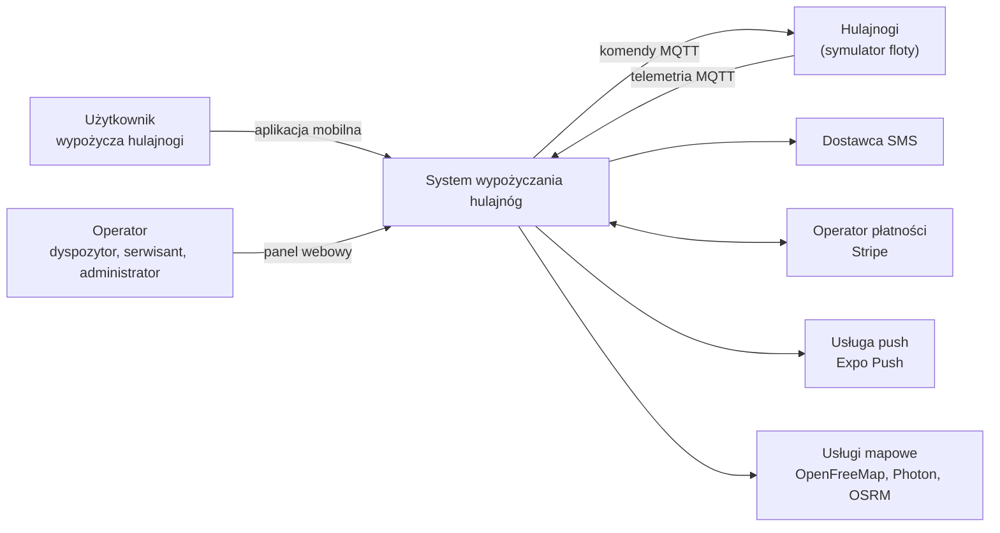

# 3. Kontekst i zakres

## 3.1. Kontekst biznesowy (C4, poziom 1)

## 3.2. Zakres

W zakresie: aplikacja mobilna (iOS, Android), aplikacja webowa (strona promocyjna i panel `/admin`), backend z API REST i WebSocket, broker MQTT, symulator floty, baza danych, skrypty wdrożeniowe.

Poza zakresem: oprogramowanie wbudowane prawdziwej hulajnogi, rzeczywiste rozliczenia finansowe, aplikacja dla serwisantów w terenie, programy lojalnościowe i kody rabatowe.

## 3.3. Interfejsy zewnętrzne

| Partner | Kanał | Kierunek | Zawartość |
|---|---|---|---|
| Aplikacja mobilna | HTTPS REST, WebSocket | dwukierunkowy | konto, mapa, przejazdy, płatności, zdarzenia na żywo |
| Panel operatora | HTTPS REST, WebSocket | dwukierunkowy | flota, strefy, cennik, zgłoszenia |
| Hulajnoga | MQTT (QoS 1) | dwukierunkowy | telemetria, status, komendy, potwierdzenia ([AsyncAPI](../kontrakty/asyncapi-mqtt.yaml)) |
| Dostawca SMS | HTTPS | wychodzący | kody logowania |
| Stripe | HTTPS, webhooki | dwukierunkowy | płatności i ich statusy |
| Expo Push | HTTPS | wychodzący | powiadomienia |
| OpenFreeMap, Photon, OSRM | HTTPS | wychodzący | kafelki, geokodowanie, trasy |
