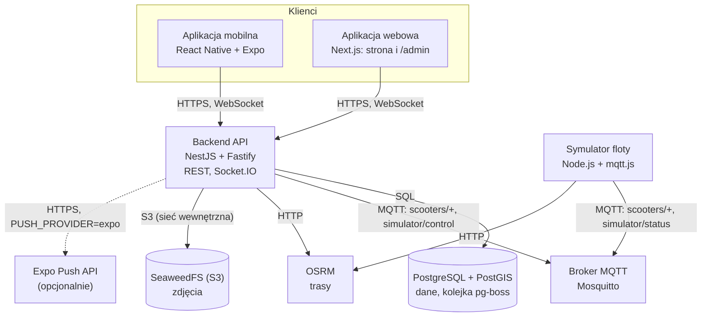

# 5. Widok bloków budujących

## 5.1. Kontenery (C4, poziom 2)



Od iteracji 6 zdjęcia idą tylko przez API, które strumieniuje je do SeaweedFS; magazyn nie jest widoczny dla klientów ([ADR 0057](../adr/0057-pliki-zdjecia.md) zmienia podpisany adres z [ADR 0024](../adr/0024-magazyn-plikow-seaweedfs.md)). Expo Push jest za portem `PushGateway`; domyślna atrapa nie łączy się z siecią ([ADR 0058](../adr/0058-powiadomienia-push-z-szablonow.md)). Tematy `simulator/*` należą do narzędzia demo, nie do kontraktu urządzeń ([ADR 0059](../adr/0059-symulator-sterowany-z-panelu.md)).

## 5.2. Moduły backendu (C4, poziom 3)

| Moduł | Odpowiedzialność | Główne tabele |
|---|---|---|
| Uwierzytelnianie | Kody SMS, tokeny, sesje, logowanie operatorów z TOTP i zaproszenia, globalny strażnik uprawnień ([ADR 0035](../adr/0035-sesje-tokeny-i-straznik-uprawnien.md)) | `otp_codes`, `sessions`, `staff_sessions`, `staff_invitations` |
| Konta | Profil, rejestracja, zgody na wersje dokumentów, blokada, zapisane miejsca, usunięcie konta | `users`, `consents`, `saved_places` |
| Dostęp | Operatorzy, role i macierz uprawnień, dziennik audytu z historią rekordu, dokumenty prawne z wersjami ([ADR 0028](../adr/0028-uzytkownicy-role-uprawnienia.md)) | `staff`, `roles`, `role_permissions`, `staff_roles`, `audit_log`, `content_pages`, `content_page_versions` |
| Flota | Stan hulajnóg i modeli, komendy i potwierdzenia, mapa floty (pokój `fleet`); od iteracji 6 komendy systemu bez wpisu w dzienniku audytu (`lock` hulajnogi bez przejazdu, `battery_swapped`) i limit potwierdzenia liczony od `expiresAt` | `scooters`, `scooter_models`, `scooter_commands` |
| Telemetria | Odbiór MQTT partiami, punkty tras, stan bieżący i przebieg ([ADR 0033](../adr/0033-telemetria-i-status-floty.md)); po zapisie partii przekazuje odczyty przejazdów modułowi Strefy; od iteracji 6 przekazuje baterię i ruch po zakończeniu modułowi Wypożyczenie, blokuje odblokowaną hulajnogę bez przejazdu, a zmianę łączności przekazuje modułowi Operacje (zgłoszenie `OFFLINE` po 5 min, zamknięcie po powrocie) | `telemetry` |
| Strefy | Geometrie stref i edytor w panelu z regułami geometrii w bazie ([ADR 0047](../adr/0047-edytor-geometrii-w-panelu.md)), bieżące strefy hulajnóg w przejeździe z histerezą ([ADR 0043](../adr/0043-wykrywanie-zmian-stref.md)), stan sterowania hulajnogą ([ADR 0044](../adr/0044-komendy-stref-dla-hulajnogi.md)), zdarzenie `zones.changed` | `zones`, `scooter_zone_presence`, `scooter_zone_control` |
| Mapy (Geo) | Trasy dla klienta z OSRM (rower, pieszo) z linią prostą jako zapasem ([ADR 0048](../adr/0048-trasy-dla-klienta-z-osrm.md)), wyszukiwanie miejsc przez Photon z pamięcią podręczną i limitem ([ADR 0045](../adr/0045-wyszukiwanie-miejsc-photon.md)) | brak (usługi zewnętrzne za adapterami) |
| Wypożyczenia | Mapa wolnych hulajnóg, rezerwacja z wygaszaniem, przejazd z komendami i potwierdzeniami, zdarzenia stref na osi czasu i komendy stref (limit, zatrzymanie) od iteracji 4, wycena, zdalne zakończenie, historia i profil klienta, usunięcie konta (pokoje `user:{id}` i `rentals`, [ADR 0036](../adr/0036-proces-wypozyczenia-w-api.md)); od iteracji 5 reguła płatności przy rezerwacji i starcie, rozliczenie w transakcji `ENDED` przez moduł Płatności i przejścia `UNPAID` z jego wyniku ([ADR 0049](../adr/0049-rozliczenie-przejazdu.md)); od iteracji 6 zakończenie bez łączności z `END_UNCONFIRMED`, naliczanie bez łączności najwyżej 30 min, progi baterii z limitem 10 km/h, `MOVED_AFTER_END`, zdjęcie parkowania ([ADR 0056](../adr/0056-przejazd-bez-lacznosci-i-niska-bateria.md)) i opłata za odholowanie przy zdalnym zakończeniu ([ADR 0060](../adr/0060-oplata-za-odholowanie.md)) | `rentals`, `rental_events` (komendy przejazdu w `scooter_commands` przez moduł Flota) |
| Zadania w tle | Kolejka pg-boss w schemacie `pgboss`: wygaśnięcie rezerwacji, limit potwierdzenia komend, partycje i retencja telemetrii, czyszczenie kodów i sesji ([ADR 0037](../adr/0037-pg-boss-konfiguracja-i-zadania.md)); od iteracji 5 obciążenie karty za przejazd, ponowienie po 24 h, przetwarzanie webhooków i sprawdzanie statusu płatności; od iteracji 6 koniec zakończenia offline po 10 min, zatrzymanie naliczania po 30 min, zgłoszenie `OFFLINE` po 5 min, wysyłka i potwierdzenia powiadomień, przypomnienie o końcu rezerwacji, czyszczenie i retencja plików | schemat `pgboss` |
| Płatności | Port `PaymentProvider` ze Stripe w trybie testowym i atrapą w procesie ([ADR 0050](../adr/0050-integracja-stripe.md)), karty (SetupIntent), doładowanie kartą i BLIK-iem, rozliczenie przejazdu z portfela albo kartą ([ADR 0049](../adr/0049-rozliczenie-przejazdu.md)), webhook z weryfikacją podpisu na surowej treści i sprawdzanie statusu, paragony z VAT i korektą ([ADR 0052](../adr/0052-paragony.md)), wersje cennika ([ADR 0053](../adr/0053-wersje-cennika-w-panelu.md)), zwroty, korekty i zwrot salda ([ADR 0054](../adr/0054-zwroty-i-korekty-salda.md)), zdarzenie `wallet.updated`; od iteracji 6 wpis `TOWING_FEE` w tej samej transakcji co `RIDE_CHARGE` i zwrot powiązany ze zgłoszeniem | `tariffs`, `wallets`, `wallet_ledger`, `payments`, `payment_methods`, `payment_customers`, `payment_webhook_events`, `refunds`, `receipts`, `receipt_items` |
| Operacje (iteracja 6) | Zgłoszenia klientów, automatyczne (`OFFLINE`, `BATTERY_CRITICAL`, `OUT_OF_ZONE`) i operatorów z osią czasu z dziennika audytu, zadania serwisowe z częściami, magazyn z ruchami, wyłączenie z ruchu i powrót do floty, pulpit „Wymaga uwagi” ([ADR 0055](../adr/0055-zgloszenia-i-proces-serwisowy.md)); pokoje `tickets` i `service`, `ticket.updated` także do `user:{id}` | `tickets`, `ticket_photos`, `service_tasks`, `service_task_parts`, `spare_parts`, `spare_part_movements` |
| Pliki (iteracja 6) | Wysyłka `POST /files` z rozpoznaniem typu po sygnaturze, limitem 10 MB i SHA-256, port `FileStorage` (S3 albo pamięć w testach), odczyt przez API z adresem podpisanym HMAC na 10 min, czyszczenie nieprzypiętych po 24 h i retencja zdjęć parkowania 30 dni ([ADR 0057](../adr/0057-pliki-zdjecia.md)) | `files` |
| Powiadomienia (iteracja 6) | Szablony ICU z wersjami i podglądem w panelu, wpis `QUEUED` w transakcji zdarzenia z kluczem idempotencji, zadanie wysyłki z preferencjami klienta, port `PushGateway` (atrapa albo Expo Push), tokeny push sesji, kod SMS z szablonu `login_code`, `notification.created` do `user:{id}` ([ADR 0058](../adr/0058-powiadomienia-push-z-szablonow.md)) | `notification_templates`, `notification_template_versions`, `notifications`, `push_tokens` |
| Symulator (iteracja 6) | Polecenia scenariuszy z panelu na `simulator/control` z wpisem `simulator.command` w dzienniku audytu, odbiór `simulator/status` i `simulator/control/result` do pokoju `simulator`; tylko przy `SIMULATOR_CONTROL_ENABLED` ([ADR 0059](../adr/0059-symulator-sterowany-z-panelu.md)) | brak (stan i wyniki w pamięci API, polecenia w `audit_log`) |

Moduły komunikują się przez publiczne serwisy i zdarzenia domenowe, nie przez bezpośredni dostęp do tabel innych modułów. Ta zasada pozwala w przyszłości wydzielić moduł do osobnej usługi.

## 5.3. Struktura repozytorium

```
apps/
  mobile/      aplikacja mobilna (Expo)
  web/         strona i panel (Next.js)
  api/         backend (NestJS)
  simulator/   symulator floty (scenariusze z panelu przez simulator/control albo z pliku dla CLI)
packages/
  core/        logika biznesowa i porty repozytoriów, bez frameworka (ADR 0025)
  shared/      schematy Zod, formaty wiadomości MQTT, typy zdarzeń
  db/          migracje, schemat Drizzle i repozytoria (implementacje portów z core)
docs/          dokumentacja
infra/         Docker Compose, konfiguracja Mosquitto, OSRM, Caddy
```
