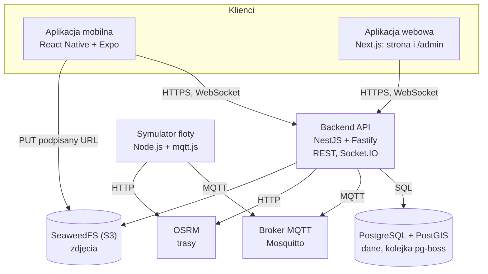

# 5. Widok bloków budujących

## 5.1. Kontenery (C4, poziom 2)



## 5.2. Moduły backendu (C4, poziom 3)

| Moduł | Odpowiedzialność | Główne tabele |
|---|---|---|
| Uwierzytelnianie | Kody SMS, tokeny, sesje, logowanie operatorów z TOTP | `otp_codes`, `sessions`, `staff` |
| Konta | Profil, zgody, zapisane miejsca, usunięcie konta | `users`, `consents`, `saved_places` |
| Flota | Stan hulajnóg i modeli, komendy i potwierdzenia, mapa floty (pokój `fleet`) | `scooters`, `scooter_models`, `scooter_commands` |
| Telemetria | Odbiór MQTT partiami, punkty tras, stan bieżący i przebieg ([ADR 0033](../adr/0033-telemetria-i-status-floty.md)), wykrywanie zmian stref (iteracja 4) | `telemetry` |
| Strefy | Geometrie stref, zapytania przestrzenne | `zones` |
| Wypożyczenia | Maszyna stanów przejazdu, rezerwacje | `rentals`, `rental_events` |
| Płatności | Cennik, portfel, Stripe, webhooki | `tariffs`, `wallets`, `wallet_ledger`, `payments` |
| Powiadomienia | Push, zdarzenia Socket.IO | `notifications`, `push_tokens` |
| Operacje | Zgłoszenia, pliki, dziennik audytu | `tickets`, `files`, `audit_log` |

Moduły komunikują się przez publiczne serwisy i zdarzenia domenowe, nie przez bezpośredni dostęp do tabel innych modułów. Ta zasada pozwala w przyszłości wydzielić moduł do osobnej usługi.

## 5.3. Struktura repozytorium

```
apps/
  mobile/      aplikacja mobilna (Expo)
  web/         strona i panel (Next.js)
  api/         backend (NestJS)
  simulator/   symulator floty
packages/
  core/        logika biznesowa i porty repozytoriów, bez frameworka (ADR 0025)
  shared/      schematy Zod, formaty wiadomości MQTT, typy zdarzeń
  db/          migracje, schemat Drizzle i repozytoria (implementacje portów z core)
docs/          dokumentacja
infra/         Docker Compose, konfiguracja Mosquitto, OSRM, Caddy
```
