# 6. Widok czasu działania

Najważniejsze scenariusze. Pełne wersje graficzne znajdują się na kanwie projektu („Przepływy techniczne”).

## 6.1. Maszyna stanów przejazdu

Przejścia decyduje maszyna stanów w `packages/core`; każde przejście to jedna transakcja z blokadą wiersza hulajnogi i przejazdu ([ADR 0036](../adr/0036-proces-wypozyczenia-w-api.md)). Pauza i wznowienie nie mają stanu przejściowego: stan zmienia się dopiero po potwierdzeniu komendy, a na czas oczekiwania przejazd ma komendę w toku (najwyżej jedną, indeks `scooter_commands_one_pending_per_rental`). Od iteracji 5 odmowa obciążenia karty po zakończeniu przenosi przejazd z `ENDED` do `UNPAID`, a spłata wraca do `ENDED` ([ADR 0049](../adr/0049-rozliczenie-przejazdu.md) zmienia przejście z [ADR 0013](../adr/0013-rezerwacja-jako-stan-przejazdu.md)). `UNPAID` nie jest stanem otwartym: hulajnoga jest wolna od chwili `ENDED`. Od iteracji 6 klient kończy przejazd także przy hulajnodze offline, a wtedy `ENDING` trwa do 10 min i kończy się `COMPLETE_END` albo `END_UNCONFIRMED` ([ADR 0056](../adr/0056-przejazd-bez-lacznosci-i-niska-bateria.md), §6.6). Koniec rezerwacji albo przejazdu przy otwartym pilnym zgłoszeniu albo zadaniu zwalnia hulajnogę do `MAINTENANCE` zamiast `AVAILABLE` (wyzwalacz `scooters_status`, [ADR 0055](../adr/0055-zgloszenia-i-proces-serwisowy.md)).

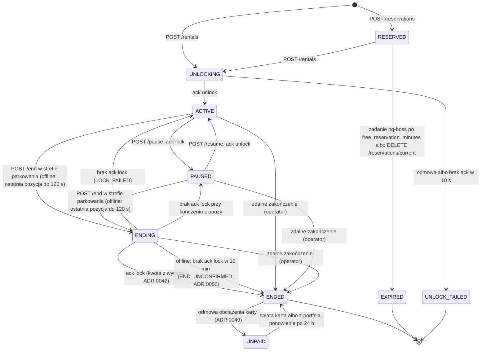

Nieudana pauza i nieudane wznowienie nie zmieniają stanu: zdarzenia `PAUSE_FAILED` i `RESUME_FAILED` są komunikatem dla klienta. Spóźnione potwierdzenie odblokowania, na które nikt nie czeka, uruchamia kompensacyjne `lock` ([ADR 0038](../adr/0038-wygasanie-komend-mqtt.md)).

## 6.2. Rozpoczęcie przejazdu

```mermaid
sequenceDiagram
    autonumber
    participant A as Aplikacja
    participant API as Backend API
    participant DB as PostgreSQL
    participant MQ as Broker MQTT
    participant H as Hulajnoga
    A->>API: POST /rentals (scooterId)
    API->>DB: BEGIN, SELECT scooter FOR UPDATE
    DB-->>API: AVAILABLE, bateria 87%
    API->>DB: INSERT rental UNLOCKING, komenda, zadanie pg-boss limitu, COMMIT
    API-->>A: 202 (rentalId, UNLOCKING)
    API->>MQ: scooters/0142/cmd unlock (commandId, expiresAt)
    MQ->>H: komenda
    H->>MQ: scooters/0142/ack (commandId, ok)
    MQ->>API: potwierdzenie
    API->>DB: rental ACTIVE, startedAt
    API-->>A: Socket.IO rental.updated ACTIVE (pokój user:ID)
    Note over API: Brak potwierdzenia w 10 s (zadanie pg-boss): UNLOCK_FAILED, bez opłaty; hulajnoga odrzuci komendę po expiresAt
```

## 6.3. Telemetria i strefy w trakcie jazdy

Odczyty są zbierane w oknie (domyślnie 1 s), oceniane regułami z `packages/core` i zapisywane jedną transakcją ([ADR 0033](../adr/0033-telemetria-i-status-floty.md)). Od iteracji 4 Telemetria po zapisie partii przekazuje odczyty hulajnóg w przejeździe (`ACTIVE`, `PAUSED`, `ENDING`) modułowi Strefy ([ADR 0043](../adr/0043-wykrywanie-zmian-stref.md)):
- **Wykrywanie (moduł Strefy):** liczy przejścia regułą `detectZoneChanges` z core: wjazd od pierwszego odczytu w strefie; wyjazd po dwóch odczytach poza strefą albo poza promieniem 10 m. Pierwszy odczyt przejazdu ustawia stan bez zdarzeń.
- **Skutki (moduł Wypożyczenie):** zapisuje `ZONE_ENTERED` i `ZONE_EXITED` na osi czasu i uzgadnia stan hulajnogi ze strefami ([ADR 0044](../adr/0044-komendy-stref-dla-hulajnogi.md)). Komenda idzie tylko przy różnicy albo po nieudanej poprzedniej:
  - limit wolnej jazdy: `speed_limit`, a bez `kmh` zdjęcie limitu;
  - zakaz i wyjazd poza obszar: `stop_gradually`, a po powrocie `release_stop`.
- **Punkty z bufora** dają zdarzenia, ale nie komendy.
- **Pauza i wznowienie:** `lock` kasuje limit i zatrzymanie w hulajnodze, więc wznowienie od razu uzgadnia stan.
- **Zmiana strefy w panelu** działa w trwających przejazdach od razu: ponowna ocena z ostatniej pozycji (pytanie 7 w planie iteracji 4).

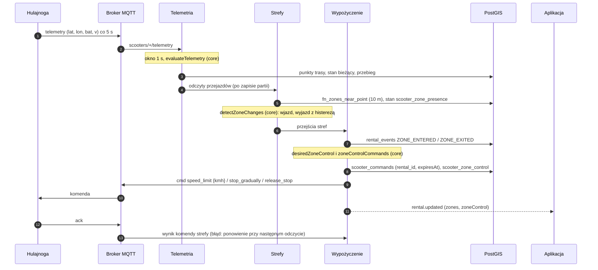

## 6.4. Zakończenie i rozliczenie

Zakończenie liczy kwotę z wersji cennika przejazdu (każda rozpoczęta minuta jazdy i pauzy, koniec naliczania przy żądaniu zakończenia, [ADR 0042](../adr/0042-wycena-przejazdu.md)). Od iteracji 5 ta sama transakcja `ENDED` rozlicza przejazd ([ADR 0049](../adr/0049-rozliczenie-przejazdu.md), decyzja D4):
- **portfel:** wpis `RIDE_CHARGE` przez `sp_wallet_post` z blokadą portfela i paragon z pozycjami z wyceny ([ADR 0052](../adr/0052-paragony.md)); saldo może spaść poniżej zera, a ujemne saldo blokuje kolejny start;
- **karta:** płatność `RIDE` w stanie `PENDING` i zadanie pg-boss `payment.charge-ride` po zatwierdzeniu; klient od razu widzi podsumowanie z „płatność w toku”.

Od iteracji 6 ta sama transakcja `ENDED`:
- zapisuje opłatę za odholowanie przy zdalnym zakończeniu poza strefą (wpis `TOWING_FEE` obok `RIDE_CHARGE` albo jedna płatność kartą na sumę, pozycja paragonu, [ADR 0060](../adr/0060-oplata-za-odholowanie.md));
- zakłada zgłoszenie automatyczne `BATTERY_CRITICAL` z zadaniem `BATTERY_SWAP`, gdy bateria spadła poniżej 10%;
- zwalnia hulajnogę do `MAINTENANCE`, gdy ma otwarte pilne zgłoszenie albo zadanie;
- planuje powiadomienie `ride_ended` (portfel; przy karcie po udanej płatności, §6.10).

Zdjęcie parkowania (pytanie 9 iteracji 6) jest krokiem po zakończeniu, więc diagram go nie pokazuje: aplikacja wysyła plik przez API, nie podpisanym adresem prosto do magazynu ([ADR 0057](../adr/0057-pliki-zdjecia.md) zmienia założenie z [ADR 0024](../adr/0024-magazyn-plikow-seaweedfs.md)):
1. Aplikacja zmniejsza zdjęcie do 1600 px i koduje jako JPEG (`expo-image-manipulator`); wersja web wybiera plik.
2. `POST /files` (`multipart/form-data`, cel `PARKING_PHOTO`): API sprawdza typ po sygnaturze, limit 10 MB, liczy SHA-256 i zapisuje obiekt w SeaweedFS przez port `FileStorage`.
3. `POST /rentals/{id}/parking-photo { fileId }` przypina plik do przejazdu (właściciel, cel, plik nieprzypięty gdzie indziej).
4. Widok przejazdu podaje adres `GET /files/{id}?exp=…&sig=…` z podpisem HMAC na 10 min, więc `Image` i `` działają bez nagłówka `Authorization`.

Przy zakończeniu bez łączności zdjęcie jest wymagane (`parkingPhotoRequired`), ale przejazd jest już rozliczony, więc API niczego nie blokuje. Zdjęcie dodaje się też w `ENDING` (blokada czeka na łączność). Nieprzypięte pliki usuwa po 24 h zadanie `files.cleanup`, a zdjęcia parkowania po 30 dniach `files.retention` (wiersz `files` zostaje ze stanem `DELETED`).

```mermaid
sequenceDiagram
    autonumber
    participant A as Aplikacja
    participant API as Backend API
    participant DB as PostGIS
    participant MQ as Broker MQTT
    participant S as Operator płatności
    A->>API: POST /rentals/current/end
    API->>DB: blokada hulajnogi i przejazdu, strefy w pozycji hulajnogi
    alt poza strefą
        API-->>A: 422 OUTSIDE_PARKING, najbliższa strefa
    else w strefie
        API->>DB: END_REQUESTED, ENDING, komenda lock, zadanie limitu, COMMIT
        API-->>A: 202 ENDING
        API->>MQ: cmd lock (expiresAt)
        alt ack lock
            MQ-->>API: ack
            alt portfel
                API->>DB: ENDED, liczniki i kwota, RIDE_CHARGE (sp_wallet_post), paragon, COMMIT
                API-->>A: rental.updated (WALLET_PAID), wallet.updated
            else karta
                API->>DB: ENDED, liczniki i kwota, payment RIDE PENDING, zadanie payment.charge-ride, COMMIT
                API-->>A: rental.updated (CARD_PENDING)
                API->>S: obciążenie bez udziału klienta (off_session, klucz idempotencji)
                alt sukces
                    S->>API: webhook payment_intent.succeeded
                    API->>DB: payment SUCCEEDED, paragon
                else odmowa (402)
                    API->>DB: payment FAILED, ENDED → UNPAID, zadanie ponowienia po 24 h
                    API-->>A: rental.updated (UNPAID), wallet.updated (zaległość)
                end
            end
        else brak ack w 10 s
            API->>DB: LOCK_FAILED, powrót do ACTIVE albo PAUSED
            API-->>A: rental.updated z komunikatem, naliczanie trwa
        end
    end
```

Zdalne zakończenie przez operatora z uprawnieniem `rentals.manage` (decyzja D7) nie sprawdza strefy i nie czeka na blokadę: przejazd od razu przechodzi do `ENDED` z tym samym rozliczeniem, naliczanie kończy się w tej chwili (albo przy wcześniejszym żądaniu klienta), komenda `lock` idzie do hulajnogi, a powód trafia na oś czasu i do dziennika audytu w tej samej transakcji. Od iteracji 6, gdy ostatnia pozycja jest poza strefą parkowania, okno ma pole „Pobierz opłatę za odholowanie” (domyślnie zaznaczone, kwota z wersji cennika przejazdu), a system zawsze zakłada zgłoszenie `OUT_OF_ZONE` z zadaniem `RELOCATION` do najbliższej strefy parkowania, także bez opłaty.

Zaległość (`UNPAID`) blokuje rezerwację i start (`PAYMENT_OVERDUE`). Spłata (`POST /rentals/{id}/pay`) z portfela to `RIDE_CHARGE` i `SETTLE_DEBT` w jednej transakcji, a kartą nowa płatność z udziałem klienta (może wymagać 3-D Secure) i `SETTLE_DEBT` po webhooku. Jedna płatność za przejazd w toku pilnuje indeks `payments_one_pending_per_rental`, więc spłata i ponowienie nie obciążą karty dwa razy.

## 6.5. Doładowanie portfela

Według makiety `15-techniczne/tech-doladowanie` ([ADR 0050](../adr/0050-integracja-stripe.md), [ADR 0051](../adr/0051-platnosci-w-aplikacji.md)). Dane karty idą z aplikacji prosto do operatora; atrapa operatora (D1) przechodzi tę samą ścieżkę z podpisem HMAC.

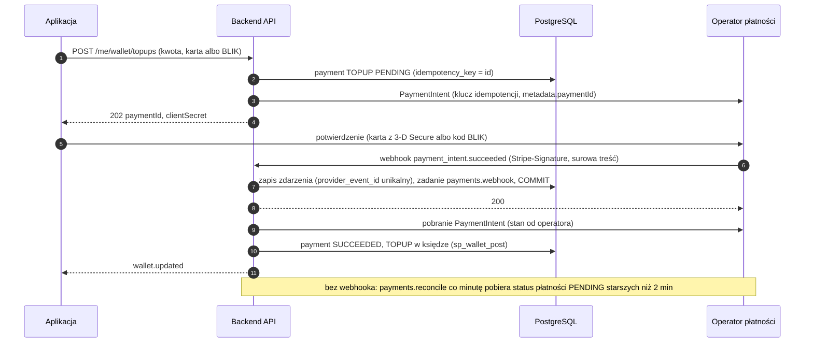

Powtórzony webhook zwiększa tylko licznik dostarczeń, a zmiany statusu płatności są monotoniczne (`PENDING → SUCCEEDED|FAILED`, `SUCCEEDED → REFUNDED`), więc kolejność zdarzeń nie ma znaczenia. Płatność z udziałem klienta bez wyniku po 30 min (porzucony BLIK, niedokończone 3-D Secure) dostaje status `FAILED` z kodem `expired`.

## 6.6. Utrata łączności z hulajnogą

Od iteracji 6 według [ADR 0056](../adr/0056-przejazd-bez-lacznosci-i-niska-bateria.md), który zmienia [ADR 0042](../adr/0042-wycena-przejazdu.md) (naliczanie) i [ADR 0036](../adr/0036-proces-wypozyczenia-w-api.md) (czas w `ENDING`):
- **Wykrycie:** Last Will daje `status offline`; przejazd dostaje `CONNECTION_LOST`, a `rental.updated` ma `scooterOnline: false` („Hulajnoga nie odpowiada”).
- **Naliczanie trwa**, ale każdy odcinek bez łączności liczy się najwyżej 30 min (`rentalCounters` w core). Bez żądania klienta zadanie `rental.offline-billing-stop` po 30 min zapisuje `BILLING_STOPPED`; przejazd trafia na pulpit „Wymaga uwagi” i kończy go operator.
- **Zgłoszenie:** zadanie `tickets.offline-check` po 5 min (singleton na hulajnogę) zakłada zgłoszenie automatyczne `OFFLINE`, jeśli hulajnoga nadal milczy. Po powrocie łączności zgłoszenie bez zadania zamyka się samo (wpis systemu `ticket.auto_closed`).
- **Zakończenie przez klienta:** przy hulajnodze offline przechodzi, gdy ostatnia pozycja ma najwyżej 120 s i leży w strefie parkowania (`canEndOffline`; inaczej `POSITION_STALE` albo `OUTSIDE_PARKING`). Naliczanie kończy się przy żądaniu, `end_mode = CUSTOMER_OFFLINE`, `lock` ma `expiresAt` za 10 min, a zdjęcie parkowania jest wymagane.
- **Wynik:** potwierdzona blokada daje `COMPLETE_END`. Brak potwierdzenia w 10 min (zadanie `rental.offline-end-timeout`), odrzucenie albo wygaśnięcie daje `END_UNCONFIRMED` (`end_mode = UNCONFIRMED`) z tą samą kwotą i zgłoszeniem `OFFLINE` w tej samej transakcji. `LOCK_FAILED` w tym trybie nie unieważnia żądania.
- **Po powrocie łączności:** broker dostarcza `lock` z sesji trwałej. Hulajnoga bez przejazdu, która zgłasza się odblokowana, dostaje `lock` systemu bez `rental_id`. Zbuforowane punkty uzupełniają trasę, a ruch ponad 200 m po żądaniu zakończenia daje `MOVED_AFTER_END`; kwota się nie zmienia, o korekcie decyduje dyspozytor.

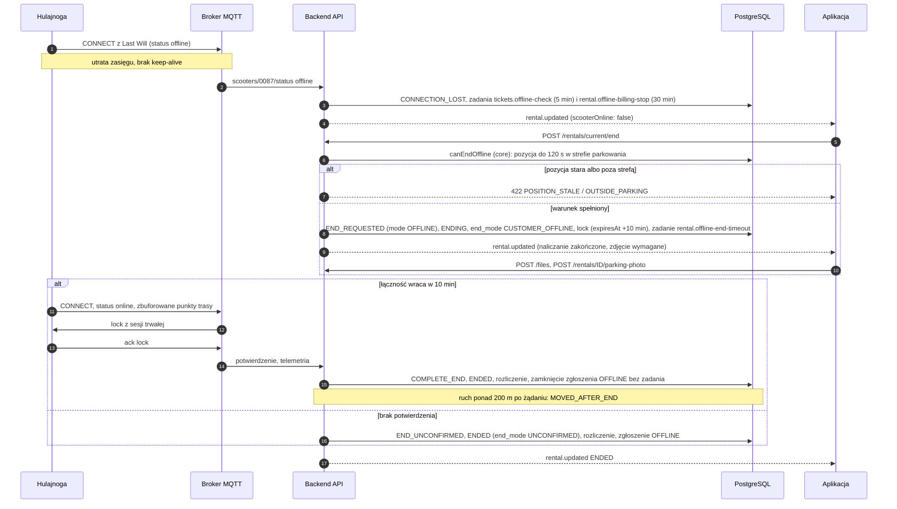

Niska bateria w jeździe (pytanie 2) idzie tą samą drogą co telemetria: próg `LOW` (minimalna bateria z cennika) zapisuje jedno `BATTERY_LOW` z `data.threshold` i planuje powiadomienie `battery_low`, a próg `CRITICAL` (5%) dokłada do uzgadniania komend stref limit 10 km/h (`desiredZoneControl` z `batteryCritical`).

## 6.7. Logowanie

Klient (iteracja 2, [ADR 0019](../adr/0019-uwierzytelnianie.md), [ADR 0035](../adr/0035-sesje-tokeny-i-straznik-uprawnien.md)): kod SMS, sesja z rotacją tokenu odświeżającego, następny ekran z `/me`.

```mermaid
sequenceDiagram
    autonumber
    participant A as Aplikacja
    participant API as Backend API
    participant C as packages/core
    participant DB as PostgreSQL
    participant SMS as Bramka SMS
    A->>API: POST /auth/otp (numer)
    API->>C: normalizePhone, ensureCanIssueOtp (60 s, 5/h)
    API->>DB: skrót HMAC kodu, ważność 5 min
    API->>SMS: kod (w środowisku deweloperskim log API)
    A->>API: POST /auth/otp/verify (numer, kod)
    API->>C: assessOtpAttempt (5 prób)
    API->>DB: zużycie kodu, konto przy pierwszym logowaniu, sesja (skrót tokenu)
    API-->>A: token dostępowy 15 min, odświeżający 30 dni, me.nextStep
    A->>A: token odświeżający w expo-secure-store
    alt nextStep = PROFILE
        A->>API: POST /me/registration (imię, wiek, wersje dokumentów)
    else nextStep = CONSENTS
        A->>API: POST /me/consents (nowe wersje dokumentów)
    end
    Note over A,API: 401 → POST /auth/refresh: nowy token w tej samej rodzinie;<br/>ponowne użycie zastąpionego tokenu unieważnia rodzinę
```

Operator panelu: hasło, drugi krok z kodem TOTP (albo jego konfiguracja), token odświeżający w ciasteczku `httpOnly`.

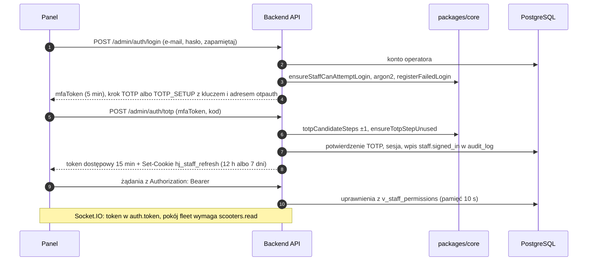

## 6.8. Komenda z panelu

Operator wysyła komendę z karty hulajnogi na mapie floty (iteracja 1). Odblokowanie poza przejazdem jest dozwolone tylko w serwisie (reguła w `packages/core`).

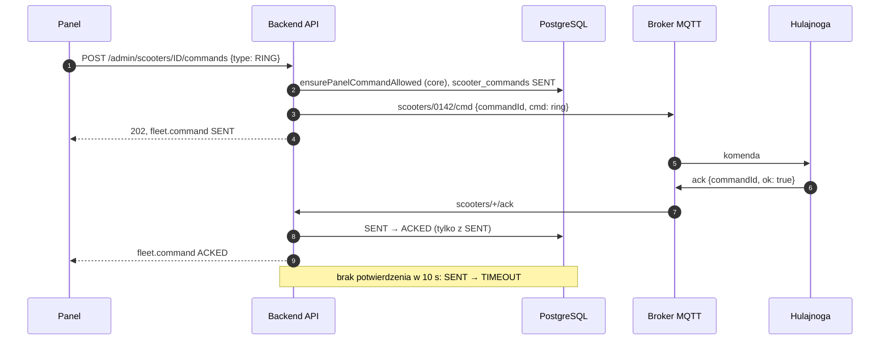

## 6.9. Proces serwisowy: od zgłoszenia do powrotu do floty

Według [ADR 0055](../adr/0055-zgloszenia-i-proces-serwisowy.md). Reguły (walidacja zgłoszenia, pilność, przejścia, skutek dla hulajnogi) liczy core, a baza pilnuje tego, czego nie może obejść równoległa transakcja: indeks jednego otwartego zgłoszenia automatycznego danego rodzaju, wyzwalacze przejść zadań, procedury magazynu z blokadą wiersza części, `CHECK (stock_qty >= 0)`.
- **Zgłoszenie:** klient (`POST /tickets`, kategorie, opis, do 3 zdjęć), system (`OFFLINE`, `BATTERY_CRITICAL`, `OUT_OF_ZONE`) albo operator. Hamulce, koło i kierownica są pilne: wolna hulajnoga przechodzi od razu do `MAINTENANCE` (przyczyna `URGENT_TICKET`), a w przejeździe po jego zakończeniu.
- **Zadanie:** dyspozytor z `service.manage` zakłada je ze zgłoszenia („Utwórz zadanie”) albo z karty hulajnogi („Wyślij do serwisu”); zgłoszenie dostaje `AT_SERVICE`. Serwisant rozpoczyna (`OPEN → IN_PROGRESS`), dodaje części (`sp_task_use_part` zmniejsza stan od razu) i kończy z notatką.
- **Zakończenie ostatniego zadania:** `returnToFleetBlockers` (core) i `fn_scooter_return_blockers` (baza) sprawdzają otwarte zadania, łączność i baterię co najmniej progu z cennika. Bez przeszkód hulajnoga wraca do `AVAILABLE` w tej samej transakcji (wpis systemu `scooter.returned_to_fleet`), inaczej zostaje w `MAINTENANCE` z przyczyną. Zgłoszenie dostaje `RESOLVED`, a klient powiadomienie.
- **Wymiana baterii:** zakończenie `BATTERY_SWAP` wysyła komendę `battery_swapped` (kontrakt MQTT 1.3.0); symulator ustawia baterię na 100%, a powrót do floty zakłada baterię po wymianie.
- **Anulowanie** zadania zwraca części ruchem `RETURN` (wyzwalacz `service_tasks_cancel_parts`).

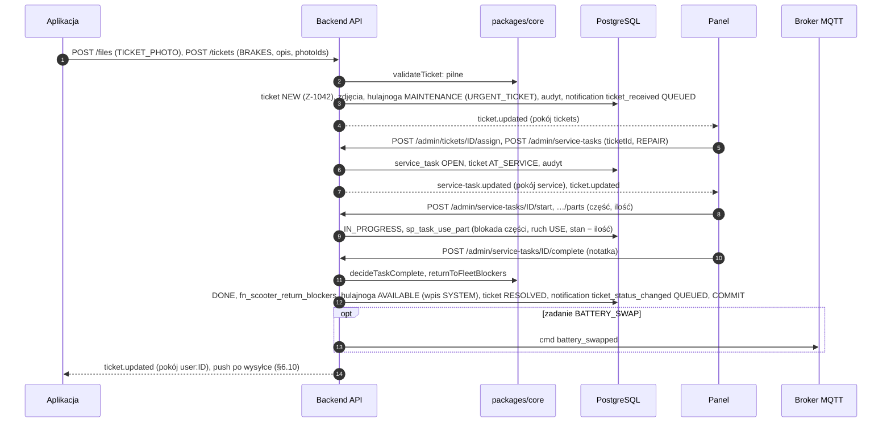

Oś czasu zgłoszenia i zadania (D6) to widok `v_ticket_timeline`: wpis o utworzeniu, wpisy dziennika audytu dla zgłoszenia i jego zadań (także wpisy systemu, `actor = SYSTEM`), zwroty powiązane przez `refunds.ticket_id` i wysłane powiadomienia. Reklamacja „Rozliczenie” nie zwraca pieniędzy sama: dyspozytor robi zwrot z okna przejazdu z `ticketId` ([ADR 0054](../adr/0054-zwroty-i-korekty-salda.md)), a odpowiedź dla klienta zapisuje przy zmianie statusu.

## 6.10. Powiadomienie: od zdarzenia do wysyłki

Według [ADR 0058](../adr/0058-powiadomienia-push-z-szablonow.md). Moduł, w którym zaszło zdarzenie (przejazd, płatność, zgłoszenie, rezerwacja), zapisuje wiersz `notifications` w stanie `QUEUED` w swojej transakcji, z kodem szablonu, parametrami, ścieżką otwarcia aplikacji i kluczem idempotencji (np. `ride_ended:{rentalId}`; unikalny `dedupe_key`). W tej samej transakcji planuje zadanie `notification.send`, więc wycofane zdarzenie nie wysyła nic.

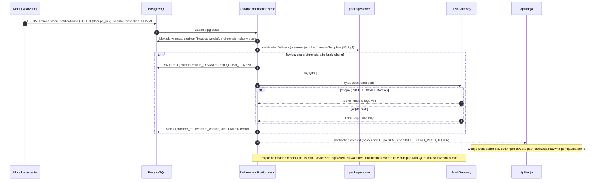

Zdarzenia i kody: `reservation_ending` (2 min przed końcem rezerwacji, preferencja `notify_reservation_end`), `ride_ended` (po rozliczeniu, preferencja `notify_receipts`), `payment_failed`, `battery_low`, `ticket_received`, `ticket_status_changed`. Kod SMS przy logowaniu renderuje szablon `login_code` (kanał `SMS`) tą samą ścieżką, ale bez kolejki. Szablon w kolejce renderuje się z wersji z chwili wysyłki.

## 6.11. Zapis sekcji treści i odświeżenie strony

Według [ADR 0062](../adr/0062-modul-tresci-sekcje-publikacja-dane-firmy.md) i [ADR 0065](../adr/0065-strona-promocyjna-z-tresci.md). Reguły sekcji (wymagane pola, limity, liczba elementów, profil Markdown, ikony, minimalna szerokość grafiki) liczy core z rejestrem sekcji z `packages/shared`. Baza pilnuje odroczonej unikalności pozycji w sekcji, schematu adresu przycisku (`CHECK` zgodny z `isAllowedHref`, od migracji 0012) i zakazu usunięcia opublikowanego wpisu.
- **Zapis:** panel wysyła całą sekcję (`PUT /admin/content-sections/{key}`) z wersją nagłówka do blokady optymistycznej. Kolejność to kolejność tablicy, element bez `id` jest nowy, a brakujący jest usuwany; opublikowany element trzeba najpierw przenieść do archiwum (`CONTENT_DELETE_PUBLISHED`). Błąd Markdown daje `422 CONTENT_VALIDATION_FAILED` z wierszem i kolumną.
- **Historia:** jeden wpis dziennika audytu na zapis sekcji, z pełnym stanem przed zmianą i po niej. „Przywróć” wczytuje wpis do edytora, a zapis tworzy nową wersję.
- **Strona:** zadanie `site.revalidate` powstaje w transakcji zapisu, tylko dla sekcji strony i przy niepustym `SITE_REVALIDATE_URL`. Route Handler strony sprawdza sekret i unieważnia tag. Bez wywołania strona pokazuje zmianę najpóźniej po 5 min (`revalidate` żądań do API).
- **Aplikacja:** zalogowana aplikacja dostaje `content.updated` i zawsze wysyła żądanie warunkowe. `GET /content/{client}` czyta treść w jednej transakcji `REPEATABLE READ`, a `ETag` to skrót SHA-256 odpowiedzi, nie licznik zmian (poprawka C1 po przeglądzie). Bez sieci aplikacja pokazuje treść z Async Storage.

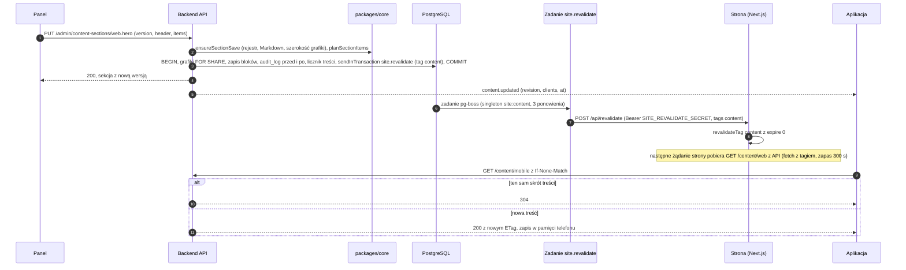

Granice publikacji aktualności (`publish_from`, `publish_to`) planuje zadanie `content.news-boundary`: zwiększa licznik treści (`sp_content_bump_revision`), odświeża tag `content` i wysyła `content.updated`, a granicę, która już nie obowiązuje, pomija. Zmiana cennika odświeża tag `tariff`, a zmiana modelu albo jego grafiki tag `scooters` (strona `/h/{numer}`).

## 6.12. Wydruk: od „Drukuj” do `document.ready`

Według [ADR 0066](../adr/0066-silnik-dokumentow-gotenberg-i-zadania.md)–[0068](../adr/0068-wydruki-w-procesach.md). „Drukuj” na karcie zadania, przejazdu, hulajnogi, zgłoszenia, paragonu albo wpisu portfela jest widoczne tylko dla rodzaju z aktywnym szablonem (`printable` w `GET /admin/document-types`). Uprawnienia: `documents.generate` i odczyt rodzaju (`ensureCanPrint`). Bez `users.read` dane klienta w pliku są zamaskowane („Klient”), a wiersz z danymi klienta pobierze tylko operator z `users.read` (`customer_data_visible`, §8.16).

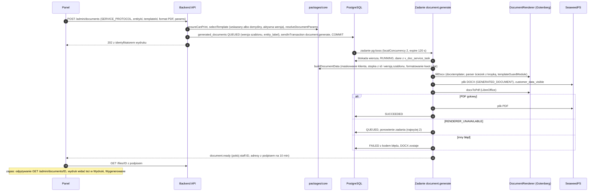

- **Naklejka z kodem QR** (`SCOOTER_LABEL`) nie ma szablonu: zadanie składa HTML z SVG z `qrcode` i tekstem z sekcji `admin.scooter-label`, a Gotenberg zamienia go na PDF przez Chromium (`htmlToPdf`).
- **Paragon PDF klienta:** `POST /me/receipts/{id}/pdf` zwraca `200` z gotowym plikiem tej samej wersji szablonu (indeks częściowy `generated_documents_receipt_reuse`) albo `202` z nowym wydrukiem; `document.ready` trafia do pokoju `user:{id}`, a aplikacja odpytuje `GET /me/documents/{id}` co 2 s jako zapas.
- **Ponowienie:** „Ponów” i „Wygeneruj ponownie” tworzą nowy wiersz z `retry_of`, z bieżących danych i aktywnej wersji szablonu.
- **Porządek:** `documents.retention` (03:30 UTC) usuwa pliki po 30 dniach (stan `DELETED`, wiersz zostaje), a `documents.sweep` co 5 min kończy wydruki porzucone po restarcie API (`RENDER_TIMEOUT` po 15 min z `document.ready`).

Zmiana szablonu przechodzi te same kroki co wydruk, ale bez zadania: wgranie (`POST /admin/document-templates/{id}/versions`) sprawdza archiwum (rozmiar, rozpakowanie z limitem, makra) i znaczniki we wszystkich częściach szablonowanych przez docxtemplater względem katalogu pól z core. Błąd daje `422 TEMPLATE_INVALID` z miejscem (część, tabela, wiersz, kolumna, akapit, bez numeru strony), a poprawna wersja ma stan `PENDING`. Podgląd PDF na danych przykładowych jest synchroniczny i zapamiętany, a „Aktywuj” i „Przywróć” wołają `sp_document_template_activate`.

## 6.13. Eksport danych klienta

Według [ADR 0069](../adr/0069-eksport-danych-klienta.md). Limit (jedno zlecenie na 24 h, nieudane się nie liczy, jedno zlecenie w toku) pilnuje procedura z blokadą klienta, a core liczy to samo dla odpowiedzi API (`dataExportNextAllowedAt`, test zgodności z `fn_data_export_next_allowed_at`).

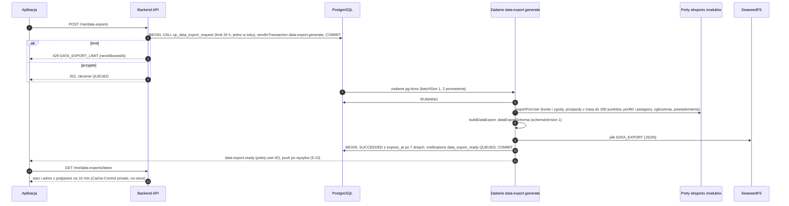

Zdjęcia trafiają do pliku tylko jako metadane. `data-exports.purge` (03:45 UTC) usuwa wygasłe pliki, a usunięcie konta zamyka zlecenie w toku (`sp_anonymize_user`: `FAILED`, `ACCOUNT_DELETED`) i usuwa pliki klienta. `data-exports.sweep` co 5 min kończy zlecenia porzucone po restarcie API (`DATA_EXPORT_FAILED` po 30 min z `data-export.ready`).

## 6.14. Raport: podgląd i eksport

Według [ADR 0071](../adr/0071-modul-raportow.md) i [ADR 0072](../adr/0072-wykresy-w-panelu-i-w-pdf.md). Katalog `GET /admin/reports` pokazuje aktywne raporty, do których operator ma uprawnienie `reports.<kod>`; raport bez uprawnienia albo wyłączony daje `404 REPORT_NOT_FOUND`. Parametry są w adresie strony raportu, więc odświeżenie i odnośnik zachowują okres, granulację i filtry.

```mermaid
sequenceDiagram
    autonumber
    participant P as Panel
    participant API as Backend API
    participant C as packages/core
    participant DB as PostgreSQL
    participant J as Zadanie report.generate
    participant R as DocumentRenderer (Gotenberg)
    participant X as SpreadsheetWriter (ExcelJS)
    participant FS as SeaweedFS
    P->>API: GET /admin/reports/revenue/preview?preset=previous_month&granularity=day
    API->>C: parametry w Europe/Warsaw (zakres do 366 dni, granulacja, porównanie, filtry raportu)
    API->>DB: BEGIN REPEATABLE READ READ ONLY, SET LOCAL jit = off, statement_timeout 15 s, fn_report_*
    API->>C: model raportu (kafelki z porównaniem, wykresy jako dane, tabele do 200 wierszy)
    API-->>P: podgląd z chwilą danych; panel rysuje wykresy z geometrii w packages/shared
    P->>API: POST /admin/reports/revenue/runs (format PDF, te same parametry)
    API->>DB: migawka jak w podglądzie (pusty raport: 409 REPORT_EMPTY)
    API->>DB: report_runs QUEUED, wpis report_run.requested, sendInTransaction report.generate, COMMIT
    API-->>P: 202 z identyfikatorem uruchomienia
    DB->>J: zadanie pg-boss (wygaśnięcie 120 s)
    J->>DB: RUNNING z żetonem started_at, migawka (zapytanie do 60 s, razem do 45 s)
    J->>C: model raportu (PDF: tabele do 50 wierszy)
    alt PDF
        J->>R: htmlToPdf (HTML z ucieczką znaków, SVG wykresów, footer.html, limit 60 s)
    else XLSX
        J->>X: arkusz na tabelę i „Parametry” (kwoty w złotych, daty Excela)
    end
    J->>FS: plik REPORT_EXPORT
    J->>DB: SUCCEEDED z data_as_of, liczbą wierszy i stron (tylko z aktualnym żetonem)
    J-->>P: report.ready (pokój staff:ID, adres pliku z podpisem na 10 min)
    Note over P: zapas: odpytywanie GET /admin/report-runs/ID co 2 s
```

- **Przejęcie:** wynik zapisuje tylko wykonanie z aktualnym żetonem `started_at`. Gdy wiersz przejęło drugie wykonanie albo zakończył go `reports.sweep`, zapisany plik jest usuwany, a `report.ready` nie idzie.
- **Błędy:** niedostępny Gotenberg wraca do kolejki, dopóki są ponowienia; inny błąd to `FAILED` z kodem (`REPORT_TIMEOUT`, `REPORT_RENDER_TIMEOUT`, `REPORT_FAILED`) i `report.ready`.
- **Ponowienie:** „Uruchom ponownie z tymi parametrami” (`POST /admin/report-runs/{id}/retry`) tworzy nowy wiersz z `retry_of`: ten sam okres i format, dane na teraz. Uruchomienie w toku daje `409 REPORT_RUN_NOT_RETRYABLE`.
- **Porządek:** `reports.sweep` co 5 min kończy uruchomienia porzucone po 15 min (`REPORT_TIMEOUT`), a `reports.retention` (03:40 UTC) usuwa pliki po 30 dniach. Wiersz zostaje, a pobranie daje `410 REPORT_FILE_DELETED`.
- **Historia** (`GET /admin/report-runs`) pokazuje uruchomienia wszystkich raportów, do których operator ma uprawnienie, także cudze; pobranie wymaga tego samego uprawnienia.

## 6.15. Eksport listy

Według [ADR 0073](../adr/0073-eksport-list-do-xlsx-i-csv.md). Każdy kontroler listy wystawia `POST /admin/{zasób}/export` z tym samym uprawnieniem co `GET` listy i woła tę samą funkcję listy, więc plik ma te same wiersze, kolejność i maskowanie danych klienta.

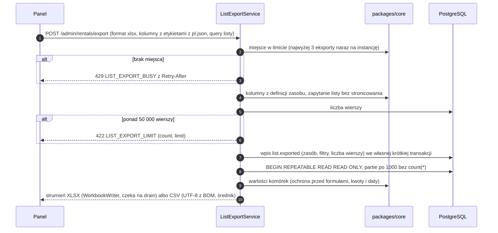

Bez `users.read` dane klienta wracają jako `null`, więc komórki są w pliku puste, a filtr albo sortowanie po polach klienta daje `403`. Telemetria ma limit 17 280 wierszy (doba odczytów co 5 s). Panel pobiera plik przez `apiDownload` z nazwą z `Content-Disposition`.
