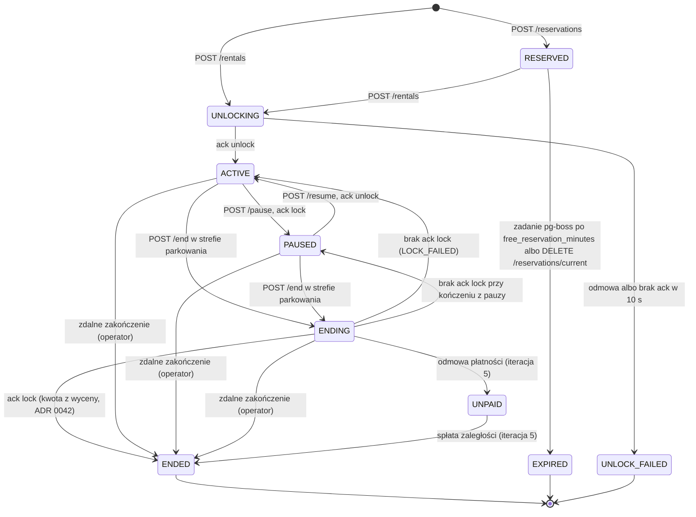
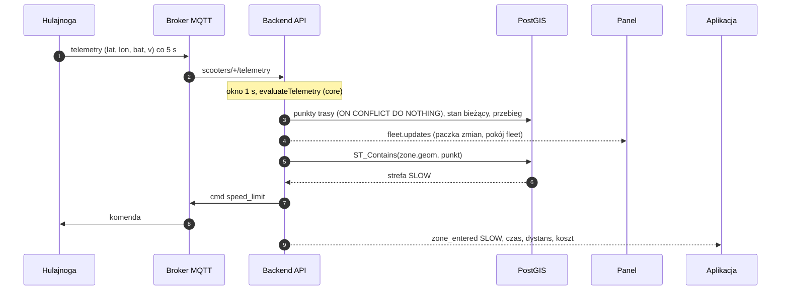
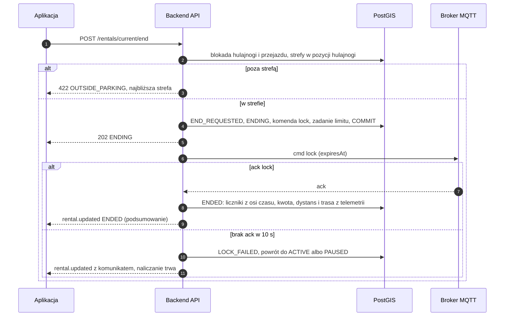
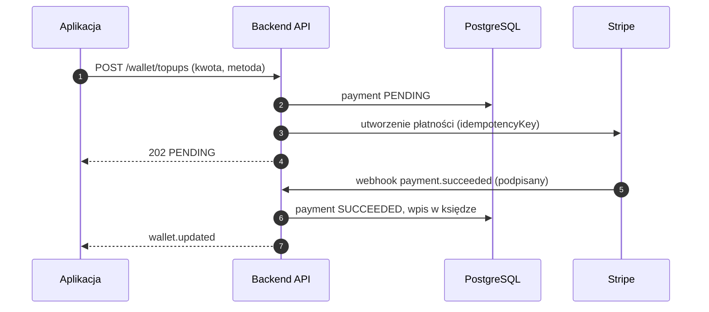
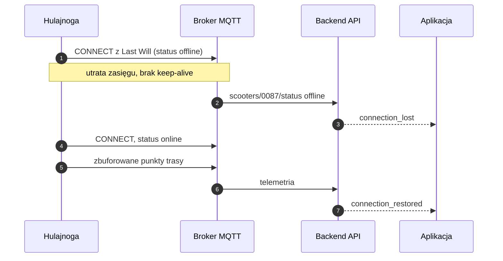
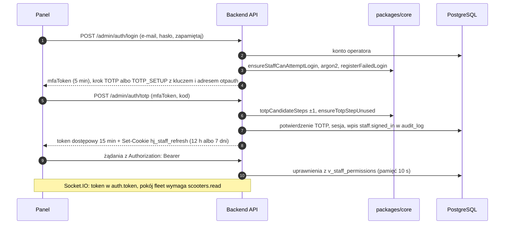
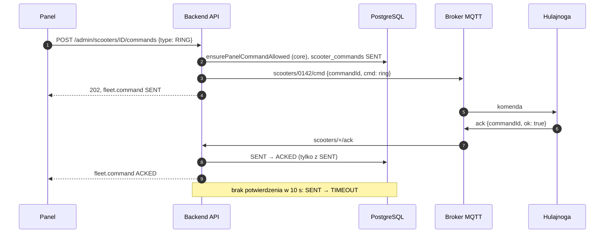

# 6. Widok czasu działania

Najważniejsze scenariusze. Pełne wersje graficzne znajdują się na kanwie projektu („Przepływy techniczne”).

## 6.1. Maszyna stanów przejazdu

Przejścia decyduje maszyna stanów w `packages/core`; każde przejście to jedna transakcja z blokadą wiersza hulajnogi i przejazdu ([ADR 0036](../adr/0036-proces-wypozyczenia-w-api.md)). Pauza i wznowienie nie mają stanu przejściowego: stan zmienia się dopiero po potwierdzeniu komendy, a na czas oczekiwania przejazd ma komendę w toku (najwyżej jedną, indeks `scooter_commands_one_pending_per_rental`). Stan `UNPAID` i obciążenie portfela wchodzą w iteracji 5.



Nieudana pauza i nieudane wznowienie nie zmieniają stanu: zdarzenia `PAUSE_FAILED` i `RESUME_FAILED` są komunikatem dla klienta. Spóźnione potwierdzenie odblokowania, na które nikt nie czeka, uruchamia kompensacyjne `lock` ([ADR 0038](../adr/0038-wygasanie-komend-mqtt.md)).

## 6.2. Rozpoczęcie przejazdu

```mermaid
sequenceDiagram
    autonumber
    participant A as Aplikacja
    participant API as Backend API
    participant DB as PostgreSQL
    participant MQ as Broker MQTT
    participant H as Hulajnoga
    A->>API: POST /rentals (scooterId)
    API->>DB: BEGIN, SELECT scooter FOR UPDATE
    DB-->>API: AVAILABLE, bateria 87%
    API->>DB: INSERT rental UNLOCKING, komenda, zadanie pg-boss limitu, COMMIT
    API-->>A: 202 (rentalId, UNLOCKING)
    API->>MQ: scooters/0142/cmd unlock (commandId, expiresAt)
    MQ->>H: komenda
    H->>MQ: scooters/0142/ack (commandId, ok)
    MQ->>API: potwierdzenie
    API->>DB: rental ACTIVE, startedAt
    API-->>A: Socket.IO rental.updated ACTIVE (pokój user:ID)
    Note over API: Brak potwierdzenia w 10 s (zadanie pg-boss): UNLOCK_FAILED, bez opłaty; hulajnoga odrzuci komendę po expiresAt
```

## 6.3. Telemetria i strefy w trakcie jazdy

Odczyty są zbierane w oknie (domyślnie 1 s), oceniane regułami z `packages/core` i zapisywane jedną transakcją ([ADR 0033](../adr/0033-telemetria-i-status-floty.md)). Wykrywanie stref i komenda limitu prędkości powstają w iteracji 4.



## 6.4. Zakończenie i rozliczenie

Od iteracji 3 zakończenie liczy kwotę z wersji cennika przejazdu (każda rozpoczęta minuta jazdy i pauzy, koniec naliczania przy żądaniu zakończenia, [ADR 0042](../adr/0042-wycena-przejazdu.md)), ale nie obciąża portfela: obciążenie, paragon i stan `UNPAID` dochodzą w iteracji 5. Zdjęcie parkowania przeszło do iteracji 6 (decyzja D2), więc w diagramie go nie ma.



Zdalne zakończenie przez operatora z uprawnieniem `rentals.manage` (decyzja D7) nie sprawdza strefy i nie czeka na blokadę: przejazd od razu przechodzi do `ENDED`, naliczanie kończy się w tej chwili (albo przy wcześniejszym żądaniu klienta), komenda `lock` idzie do hulajnogi, a powód trafia na oś czasu i do dziennika audytu w tej samej transakcji.

## 6.5. Doładowanie portfela



## 6.6. Utrata łączności z hulajnogą



## 6.7. Logowanie

Klient (iteracja 2, [ADR 0019](../adr/0019-uwierzytelnianie.md), [ADR 0035](../adr/0035-sesje-tokeny-i-straznik-uprawnien.md)): kod SMS, sesja z rotacją tokenu odświeżającego, następny ekran z `/me`.

```mermaid
sequenceDiagram
    autonumber
    participant A as Aplikacja
    participant API as Backend API
    participant C as packages/core
    participant DB as PostgreSQL
    participant SMS as Bramka SMS
    A->>API: POST /auth/otp (numer)
    API->>C: normalizePhone, ensureCanIssueOtp (60 s, 5/h)
    API->>DB: skrót HMAC kodu, ważność 5 min
    API->>SMS: kod (w środowisku deweloperskim log API)
    A->>API: POST /auth/otp/verify (numer, kod)
    API->>C: assessOtpAttempt (5 prób)
    API->>DB: zużycie kodu, konto przy pierwszym logowaniu, sesja (skrót tokenu)
    API-->>A: token dostępowy 15 min, odświeżający 30 dni, me.nextStep
    A->>A: token odświeżający w expo-secure-store
    alt nextStep = PROFILE
        A->>API: POST /me/registration (imię, wiek, wersje dokumentów)
    else nextStep = CONSENTS
        A->>API: POST /me/consents (nowe wersje dokumentów)
    end
    Note over A,API: 401 → POST /auth/refresh: nowy token w tej samej rodzinie;<br/>ponowne użycie zastąpionego tokenu unieważnia rodzinę
```

Operator panelu: hasło, drugi krok z kodem TOTP (albo jego konfiguracja), token odświeżający w ciasteczku `httpOnly`.



## 6.8. Komenda z panelu

Operator wysyła komendę z karty hulajnogi na mapie floty (iteracja 1). Odblokowanie poza przejazdem jest dozwolone tylko w serwisie (reguła w `packages/core`).


