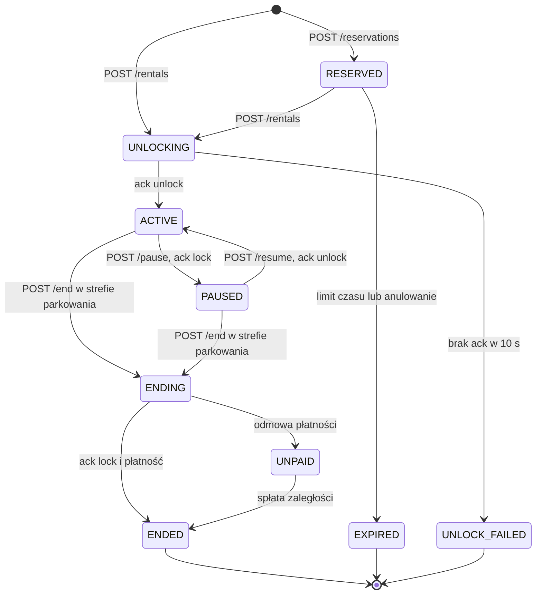
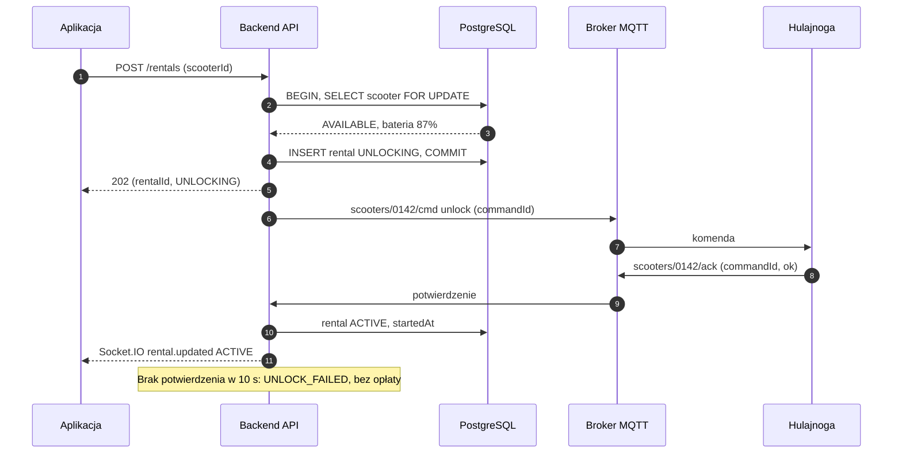
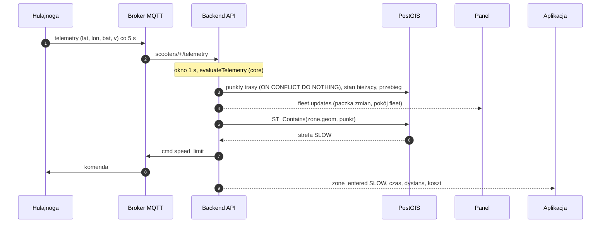
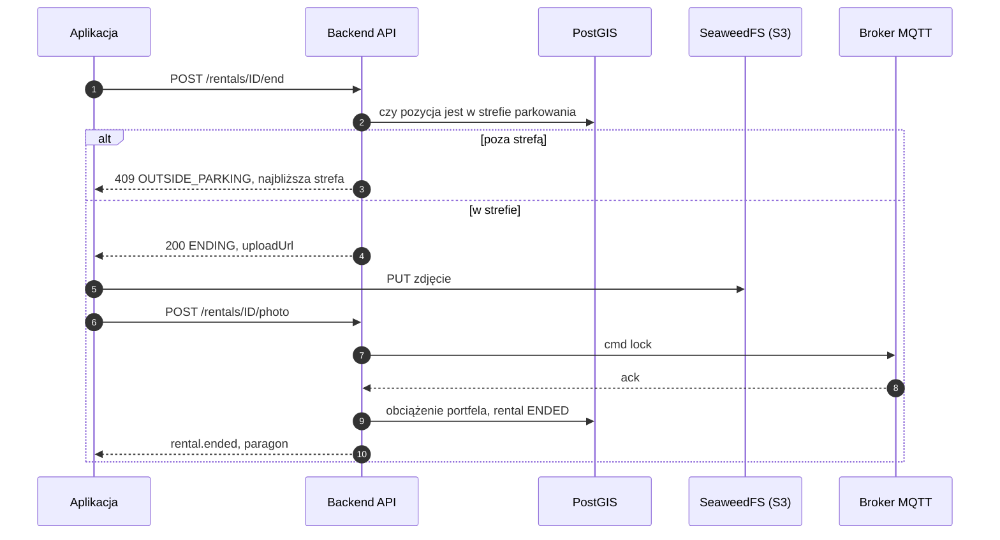
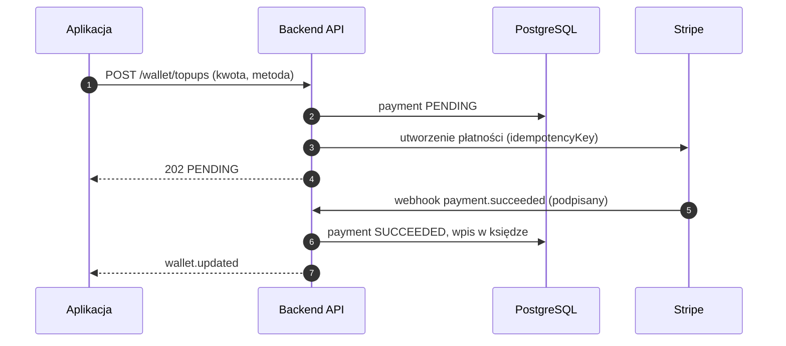
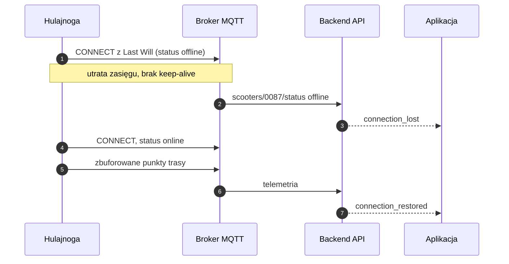
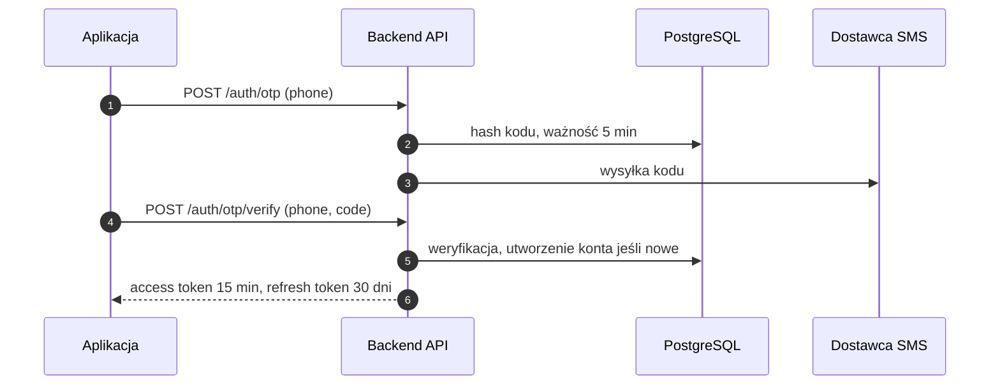
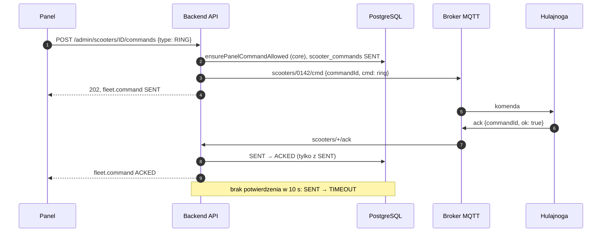

# 6. Widok czasu działania

Najważniejsze scenariusze. Pełne wersje graficzne znajdują się na kanwie projektu („Przepływy techniczne”).

## 6.1. Maszyna stanów przejazdu

## 6.2. Rozpoczęcie przejazdu

## 6.3. Telemetria i strefy w trakcie jazdy

Odczyty są zbierane w oknie (domyślnie 1 s), oceniane regułami z `packages/core` i zapisywane jedną transakcją ([ADR 0033](../adr/0033-telemetria-i-status-floty.md)). Wykrywanie stref i komenda limitu prędkości powstają w iteracji 4.

## 6.4. Zakończenie i rozliczenie

## 6.5. Doładowanie portfela

## 6.6. Utrata łączności z hulajnogą

## 6.7. Logowanie

## 6.8. Komenda z panelu

Operator wysyła komendę z karty hulajnogi na mapie floty (iteracja 1). Odblokowanie poza przejazdem jest dozwolone tylko w serwisie (reguła w `packages/core`).

