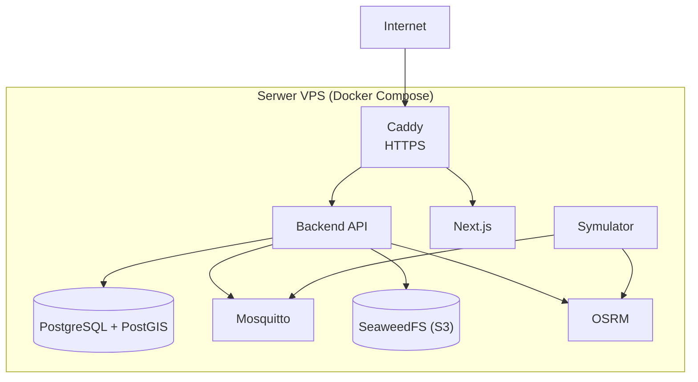

# 7. Widok wdrożenia

## 7.1. Środowisko deweloperskie

Docker Compose uruchamia: PostgreSQL z PostGIS, Mosquitto, SeaweedFS (magazyn zgodny z S3), OSRM (wycinek województwa śląskiego z Geofabrik). Backend, aplikacja webowa i symulator działają lokalnie w trybie deweloperskim. Aplikacja mobilna działa w Expo na telefonie lub emulatorze.

SMS-y w tym środowisku nie są wysyłane, kod trafia do logów backendu.

## 7.2. Środowisko demonstracyjne

## 7.3. Ciągła integracja

GitHub Actions dla każdej zmiany: lint, sprawdzenie typów, testy jednostkowe i integracyjne (Testcontainers), budowanie obrazów. Wdrożenie na VPS ręcznie lub po oznaczeniu wersji.
