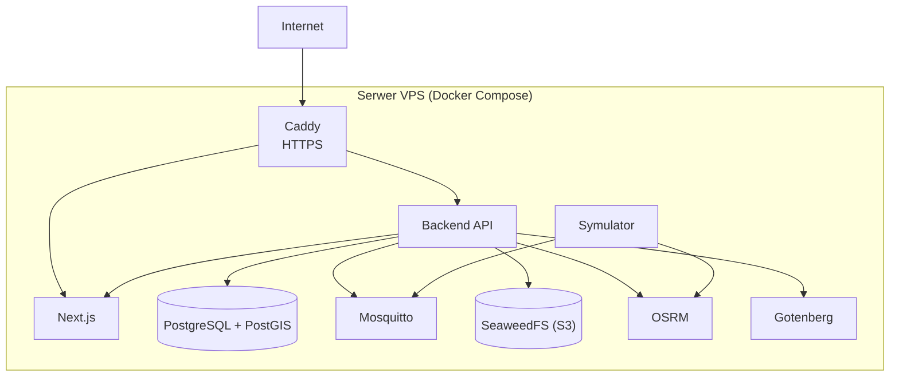

# 7. Widok wdrożenia

## 7.1. Środowisko deweloperskie

Docker Compose uruchamia: PostgreSQL z PostGIS, Mosquitto, SeaweedFS (magazyn zgodny z S3), OSRM (wycinek województwa śląskiego z Geofabrik), od iteracji 7 Gotenberg. Backend, aplikacja webowa i symulator działają lokalnie w trybie deweloperskim. Aplikacja mobilna działa w Expo na telefonie lub emulatorze.

Gotenberg ([ADR 0066](../adr/0066-silnik-dokumentow-gotenberg-i-zadania.md)):
- obraz budowany z `infra/gotenberg/Dockerfile` na `gotenberg/gotenberg:9.5.1` (przypięty skrótem `sha256`) z czcionką Inter 4.1 (`infra/gotenberg/fonts/inter/`); pierwszy `pnpm infra:up` buduje warstwę czcionek;
- port tylko na pętli zwrotnej: `127.0.0.1:${GOTENBERG_PORT:-3010}` → 3000 w kontenerze, bo API w środowisku deweloperskim działa poza Compose (`GOTENBERG_URL=http://localhost:3010`);
- `mem_limit` 1536 MB, limit żądania 30 s, healthcheck `/health`; zmienne blokują pobieranie i wysyłanie czegokolwiek przez silnik (`API_DISABLE_DOWNLOAD_FROM`, `WEBHOOK_DISABLE`, blokada adresów prywatnych i publicznych, Chromium bez JavaScriptu) i trasy przetwarzania PDF;
- API wybiera silnik zmienną `DOCUMENT_RENDERER`: `gotenberg` (domyślnie) albo `fake` (stały PDF w testach API; w produkcji zatrzymuje start). Stan silnika podaje `GET /health` (`documents: up|down`).

Od iteracji 8 nie ma nowego kontenera. Raporty PDF idą przez tego samego Gotenberga (Chromium), a XLSX i CSV zapisuje proces API (ExcelJS 4.4.0, zależność `apps/api`). Dane do raportów daje generator `pnpm db:history` na osobnej, świeżej bazie w tym samym kontenerze PostgreSQL (np. `hulajnogi_history`), bo generator odmawia na bazie z przejazdami ([ADR 0075](../adr/0075-dane-historyczne-do-demonstracji.md)); `.claude/launch.json` ma do niej API `api-history` (3005) i panel `web-reports` (3007).

SMS-y w tym środowisku nie są wysyłane, kod trafia do logów backendu.

## 7.2. Środowisko demonstracyjne

W środowisku demonstracyjnym Gotenberg jest tylko w sieci wewnętrznej Compose (bez portu na zewnątrz), a API woła `POST /api/revalidate` strony po adresie wewnętrznym (`SITE_REVALIDATE_URL`); strona czyta API po `API_INTERNAL_URL`.

## 7.3. Ciągła integracja

GitHub Actions dla każdej zmiany: lint, sprawdzenie typów, testy jednostkowe i integracyjne (Testcontainers), budowanie obrazów. Wdrożenie na VPS ręcznie lub po oznaczeniu wersji.
