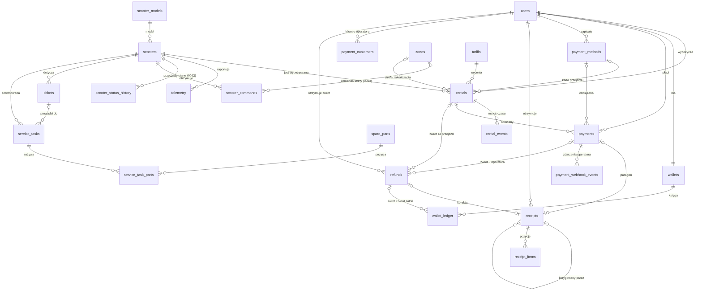
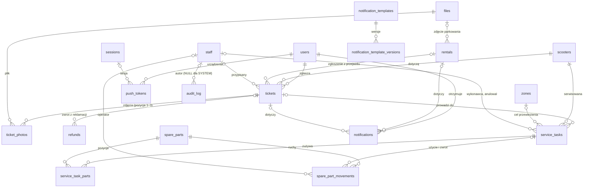
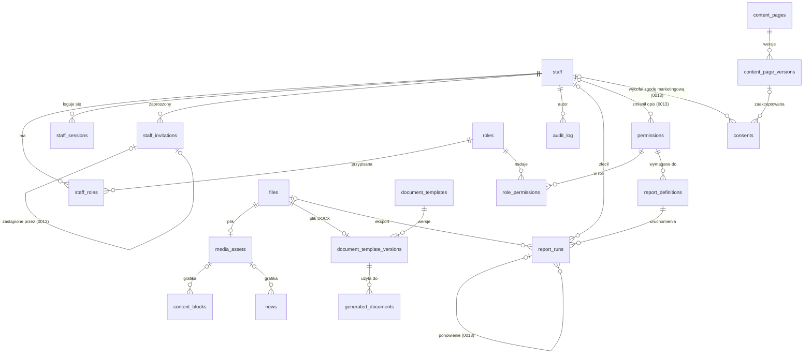
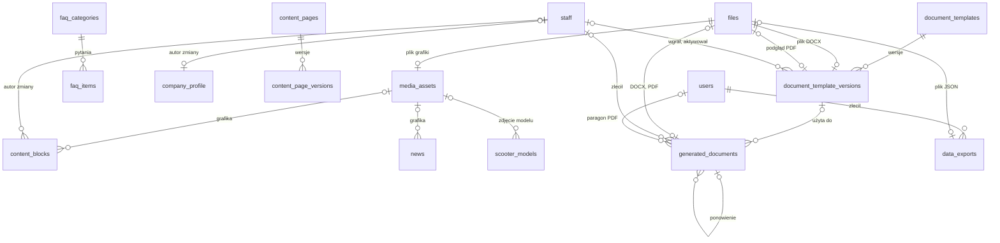

# Model danych

PostgreSQL 16 z PostGIS. Źródłem prawdy o schemacie są migracje w [`packages/db/migrations`](../../packages/db/migrations) ([ADR 0021](../adr/0021-migracje-sql-schemat-drizzle-z-bazy.md)):

- `0001_init.sql`: schemat początkowy, 24 tabele. Jego projekt z komentarzami to [`schema.sql`](schema.sql) (wersja 1, sprawdzona na PostgreSQL 16 i PostGIS 3.4).
- `0002_admin_modules.sql`: role i uprawnienia, treści, raporty, wydruki, serwis i paragony oraz widoki, funkcje i procedury ([ADR 0026](../adr/0026-logika-w-bazie-widoki-funkcje-procedury.md)–[0031](../adr/0031-wzorzec-widoku-tabeli-w-panelu.md)).
- `0003_fleet_lists.sql` (iteracja 1): status floty widoczny dla operatora (`fn_fleet_status`, `fn_low_battery_threshold`), listy floty i modeli w panelu (`v_fleet_list`, `v_scooter_models`), indeksy sortowania po ostatnim sygnale i komend bez potwierdzenia ([ADR 0033](../adr/0033-telemetria-i-status-floty.md)).
- `0004_accounts_access.sql` (iteracja 2): sesje i zaproszenia operatorów (`staff_sessions`, `staff_invitations`), TOTP potwierdzony kodem i blokada po nieudanych logowaniach, blokada klienta z powodem, rodziny tokenów odświeżających, „najważniejsze zmiany” wersji dokumentu, listy ról, klientów, zgód i dziennika audytu, strażnik ostatniego operatora z `roles.manage` ([ADR 0019](../adr/0019-uwierzytelnianie.md), [ADR 0028](../adr/0028-uzytkownicy-role-uprawnienia.md)).
- `0005_rentals.sql` (iteracja 3): nowe zdarzenia osi czasu (`END_REQUESTED`, `PAUSE_FAILED`, `RESUME_FAILED`, `LOCK_FAILED`, `ENDED_REMOTELY`, `LATE_UNLOCK_LOCKED`), termin ważności i powód odmowy komendy, najwyżej jedna komenda w toku na przejazd, portfel zakładany wyzwalaczem przy rejestracji (i uzupełniony dla istniejących klientów), preferencje powiadomień klienta, saldo różne od 0 blokujące usunięcie konta, widoki przejazdów w panelu, osi czasu, historii i statystyk klienta, trasa przejazdu z telemetrii, czyszczenie sesji i zaproszeń ([ADR 0036](../adr/0036-proces-wypozyczenia-w-api.md)–[0042](../adr/0042-wycena-przejazdu.md)).

- `0006_zones.sql` (iteracja 4): reguły geometrii stref pilnowane wyzwalaczem `zones_rules` (strefa w jedynym aktywnym obszarze działania, strefy parkowania bez części wspólnej, typ niezmienny, obszaru działania nie można wyłączyć), limit tylko w strefie wolnej jazdy, bieżące strefy i stan sterowania hulajnogą w przejeździe (`scooter_zone_presence`, `scooter_zone_control`), komenda `RELEASE_STOP`, jedna oczekująca komenda przejazdu tylko dla `LOCK` i `UNLOCK`, hulajnogi w strefie zakazu i poza obszarem poza mapą klienta, widoki edytora stref i zajętości parkowania, funkcje stref w promieniu, najbliższego parkowania i skutków zmiany strefy, usunięcie tylko nieużytej strefy ([ADR 0043](../adr/0043-wykrywanie-zmian-stref.md), [0044](../adr/0044-komendy-stref-dla-hulajnogi.md), [0047](../adr/0047-edytor-geometrii-w-panelu.md)).

- `0007_payments.sql` (iteracja 5): klient u operatora płatności (`payment_customers`), zwroty (`refunds`), typ wpisu `PAYOUT` i powód korekty w księdze, zapis do księgi z blokadą portfela (`sp_wallet_post`) i wyzwalacz salda po operacji, karta przejazdu, jedna płatność za przejazd w toku, webhooki z wynikiem i liczbą dostarczeń, paragony z rodzajem, korektą, sposobem zapłaty i sprzedawcą, stawka VAT w wersji cennika, wersje cennika nieedytowalne z najwyżej jedną zaplanowaną, stan rozliczenia przejazdu w widoku, listy płatności w panelu i historia portfela ([ADR 0049](../adr/0049-rozliczenie-przejazdu.md)–[0054](../adr/0054-zwroty-i-korekty-salda.md)).

- `0008_operations.sql` (iteracja 6): zgłoszenia z numerem z sekwencji, rodzajem zgłoszenia automatycznego (jedno otwarte danego rodzaju na hulajnogę), odpowiedzią dla klienta z czasem odczytu i pilnością z kategorii; nowe kategorie `BILLING` i `OUT_OF_ZONE`; aktor `SYSTEM` w dzienniku audytu; przyczyna i czas zmiany stanu hulajnogi z wyzwalaczem `MAINTENANCE` po przejeździe; przejścia zadań serwisowych w bazie, cel przewiezienia i powód anulowania; ruchy magazynowe (`spare_part_movements`) przez procedury; powrót do floty (`fn_scooter_return_blockers`); tryb zakończenia przejazdu i opłata za odholowanie (`TOWING_FEE`) w rozliczeniu; stan, SHA-256 i usunięcie pliku bez usuwania wiersza; powiadomienia z kodem szablonu, kanałem, stanem wysyłki i kluczem idempotencji, tokeny push z sesją, wersje szablonów (`notification_template_versions`); komenda `BATTERY_SWAPPED`; `service.manage` dla Dyspozytora; widoki list panelu, oś czasu zgłoszenia i pulpit „Wymaga uwagi” ([ADR 0055](../adr/0055-zgloszenia-i-proces-serwisowy.md)–[0060](../adr/0060-oplata-za-odholowanie.md)).
- `0009_operations_fixes.sql` (iteracja 6, poprawki po przeglądzie): wyzwalacz `scooters_status` dopasowuje przyczynę stanu do nowego stanu, gdy zmiana stanu nie podaje przyczyny (`OTHER` przy wejściu do `MAINTENANCE` albo `RETIRED` z niepasującą przyczyną albo bez niej); `fn_scooter_return_blockers` z przeszkodą `URGENT_TICKET` (otwarte pilne zgłoszenie); unikalne indeksy `rentals_parking_photo_unique` i `ticket_photos_file_unique` (plik przypięty w jednym miejscu) zamiast zwykłych z 0008; `notifications.claimed_at` (przejęcie przed wysyłką); szablony wszystkich kodów z rejestru, żeby baza po samym `db:migrate` wysyłała SMS z kodem logowania.
- `0010_towing_fee_outside_vat.sql` (iteracja 6, [ADR 0061](../adr/0061-oplata-za-odholowanie-jako-kara-umowna.md)): opłata za odholowanie jako kara umowna poza VAT. `receipt_items.vat_rate` dopuszcza `NULL` („nie podlega VAT”, w dokumencie „np.”); `v_receipt_list` liczy `vat_amount` osobno dla każdej stawki (`fn_vat_from_gross` na sumie brutto grupy, pozycje `NULL` bez VAT), a `vat_rate` to stawka pozycji z VAT, gdy jest jedna; `sp_issue_receipt` odrzuca korektę, po której któraś grupa stawek paragonu (sprzedaż plus korekty) byłaby ujemna, także korektę ze stawką spoza paragonu (`RECEIPT_CORRECTION_EXCEEDS`). Paragony sprzed migracji zostają bez zmian.
- `0011_content_documents.sql` (iteracja 7, [ADR 0062](../adr/0062-modul-tresci-sekcje-publikacja-dane-firmy.md)–[0069](../adr/0069-eksport-danych-klienta.md)): bloki treści jako sekcje z rejestru w `packages/shared` (klucz sekcji z pozycją, unikalność `(key, position)` odroczona, ikona z zamkniętej listy, prefiks klucza według klienta, dozwolone schematy adresu przycisku); kategorie FAQ (`faq_categories`) z kolejnością i widocznością pytań na stronie i w aplikacji; aktualności z wymaganą zajawką, czasem pierwszej publikacji, slugiem niezmiennym po niej i stanem z dat (`fn_news_state`); dane firmy w jednym wierszu (`company_profile`, zamiast `SELLER_*`, z polami rejestrowymi); opublikowanego bloku, pytania ani aktualności nie da się usunąć; biblioteka mediów z nazwą, flagą grafiki systemowej (`scooter.*`), wymiarami pliku (`files.width`, `height`), kluczem niezmiennym, kluczami obcymi `RESTRICT` i publicznym adresem z sumą (`fn_media_path`); licznik treści także przy kategoriach FAQ, danych firmy i modelach, `sp_content_bump_revision` dla granic aktualności; blokada optymistyczna wersji roboczej dokumentu prawnego (`content_page_versions.version`); wersje szablonów DOCX z autorem i czasem aktywacji, ostrzeżeniami, rozmiarami i podglądem PDF, niezmienne po wgraniu, aktywacja i przywrócenie (`sp_document_template_activate`), szablon domyślny (`sp_document_template_set_default`); wydruki z formatem, etykietą obiektu, czasem startu, kodem błędu, retencją plików, ponowieniem (`retry_of`) i naklejką QR bez szablonu (`SCOOTER_LABEL`), ponowne użycie paragonu PDF klienta (`generated_documents_receipt_reuse`); eksport danych klienta (`data_exports`, cel pliku `DATA_EXPORT`, limit raz na dobę w `sp_data_export_request`, `fn_data_export_next_allowed_at`, zamknięcie zlecenia przy anonimizacji); uprawnienie `company.write` i rola Redaktor; szablon powiadomienia `data_export_ready`; widoki publiczne treści, widoki list panelu i widoki danych wydruków `v_doc_*`. Nowe wartości typów (`SCOOTER_LABEL`, `DATA_EXPORT`) w ograniczeniach i widokach porównywane jako tekst, jak w 0008.
- `0012_iteration7_fixes.sql` (iteracja 7, poprawki po przeglądzie): `generated_documents.customer_data_visible` (`boolean NOT NULL DEFAULT false`, zapisywane przy wypełnieniu szablonu: plik ma dane klienta bez maskowania; pobranie, szczegóły i ponowienie takiego wydruku wymagają `users.read`, [ADR 0068](../adr/0068-wydruki-w-procesach.md)), wiersze sprzed migracji rodzajów z polami klienta dostają `true`; `v_generated_documents` z nową kolumną na końcu; `CHECK content_blocks_cta_url` z wzorcem `ALLOWED_HREF_PATTERN` (bez ukośnika wstecznego, znaków sterujących i ponad 2000 znaków, zgodność z `isAllowedHref` sprawdza test bazy); indeksy częściowe `generated_documents_open_idx (created_at)` i `data_exports_open_idx (requested_at)` dla wierszy `QUEUED`/`RUNNING` (zadania porządkowe `documents.sweep` i `data-exports.sweep` kończą porzucone po restarcie API). Liczby tabel, widoków, funkcji i procedur się nie zmieniają.
- `0013_reports.sql` (iteracja 8, [ADR 0071](../adr/0071-modul-raportow.md), [0074](../adr/0074-historia-stanow-hulajnogi.md), [0076](../adr/0076-domkniecie-macierzy-operacji.md)): uprawnienie `reports.manage` (Administrator); opis uprawnienia z blokadą optymistyczną (`permissions.updated_at`, `updated_by`, `version`, opis do 160 znaków); nazwa (do 80 znaków) i opis (do 300) definicji raportu; uruchomienia raportów z chwilą danych (`data_as_of`), kodem błędu (`error_code`), liczbą wierszy i stron, ponowieniem (`retry_of`) i usunięciem pliku po retencji (`file_deleted_at`), bez CSV, z indeksami historii i porządków; historia stanów hulajnogi (`scooter_status_history`, rozszerzenie `btree_gist` dla ograniczenia wykluczającego) z wyzwalaczami na `scooters`, ochroną tylko do dopisywania, przedziałem otwartym dla istniejących hulajnóg i widokiem z przyczyną i kategorią czasu; 34 funkcje raportowe i pomocnicze (`fn_report_*`, `fn_report_buckets`, `fn_scooter_time_category`, `fn_ticket_is_failure`, `fn_wallet_balances_at`, `fn_dashboard_rides_by_hour`, `fn_telemetry_readings`); kolumny z ADR 0076 (`consents.source`, `revoked_by_staff`; `sessions.platform`, `app_version`; `otp_codes.purpose`; `scooter_commands.source` z wyzwalaczem uzupełniającym i `zone_id`; `staff_invitations.replaced_by`; `staff_sessions.remembered`; `document_templates.deactivated_at`; `telemetry.locked`, `buffered`) z uzupełnieniem starych wierszy; dezaktywacja i ponowna aktywacja szablonu wydruku; `v_low_stock_parts` z regułą `<`, przyczyna korekty w `v_doc_receipt`, pola aktywnej wersji i wydruki z 30 dni w `v_document_templates`; 15 widoków nowych list; indeksy pod funkcje raportowe. Cel pliku raportu to istniejące od 0002 `REPORT_EXPORT` (bez nowej wartości typu).
- `0014_iteration8_fixes.sql` (poprawki po przeglądzie iteracji 8, [ADR 0071](../adr/0071-modul-raportow.md), [0074](../adr/0074-historia-stanow-hulajnogi.md)): przyczyna w `v_scooter_status_history` dopasowuje przejazd od rezerwacji albo utworzenia (faza UNLOCKING przed `started_at`), a rezerwacja wygasła i nieudane odblokowanie bez `ended_at` kończą się w chwili przejścia do `EXPIRED`/`UNLOCK_FAILED` (zdarzenie `STATE_CHANGED`, inaczej `updated_at`); `duration_ms` w `v_report_run_list` i `response_ms` w `v_scooter_command_list` jako `bigint` (widoki usunięte i utworzone od nowa, bez zależności); `fn_wallet_balances_at` bierze ostatni wpis klienta po `id`, jak wyzwalacz ciągłości księgi; `fn_report_buckets` zwraca jako `bucket` datę początku przedziału po przycięciu do okresu (pierwszy tydzień okresu od 1 października to tydzień od 01.10); `fn_report_fleet_usage_by_scooter` i `fn_report_fleet_usage_series` zaokrąglają kategorie z sum narastających, więc suma kategorii równa się `tracked_seconds`.

Po migracji 0014 baza ma **58 tabel**, **79 widoków**, **58 funkcji** i **24 procedury** (bez partycji telemetrii, schematu `pgboss` i funkcji rozszerzeń). Migracja 0013 dodaje 1 tabelę (`scooter_status_history`), 15 widoków, 34 funkcje i 2 procedury; migracja 0014 tych liczb nie zmienia (zastępuje widoki i funkcje).

Po migracji 0011 baza ma **57 tabel** (bez partycji telemetrii i bez schematu `pgboss` kolejki zadań, [ADR 0037](../adr/0037-pg-boss-konfiguracja-i-zadania.md)), **64 widoki**, **24 funkcje** i **22 procedury** (stan po 0008: 54 tabele, 42 widoki, 21 funkcji, 18 procedur; migracje 0009, 0010 i 0012 tych liczb nie zmieniają, bo zastępują funkcje, procedurę, widoki i ograniczenia, dodają kolumny i indeksy). Migracja 0011 dodaje 3 tabele (`faq_categories`, `company_profile`, `data_exports`), 22 widoki, 3 funkcje i 4 procedury. Liczby sprawdza test w `packages/db/src/db.test.ts`. Kluczowe zasady opisują też [ADR 0010](../adr/0010-postgresql-postgis-drizzle.md), [ADR 0013](../adr/0013-rezerwacja-jako-stan-przejazdu.md), [ADR 0014](../adr/0014-kwoty-w-groszach-portfel-ksiega.md) i [ADR 0015](../adr/0015-wersjonowany-cennik.md).

## Obszary

| Obszar | Tabele |
|---|---|
| Konta | `users`, `consents`, `otp_codes`, `sessions`, `push_tokens`, `saved_places`, `staff`, `staff_sessions`, `staff_invitations` |
| Role i uprawnienia | `permissions`, `roles`, `role_permissions`, `staff_roles` |
| Przejazdy | `rentals`, `rental_events`, `tariffs` |
| Flota i strefy | `scooters`, `scooter_models`, `scooter_status_history` (0013), `telemetry` (partycje dzienne), `scooter_commands`, `zones`, `scooter_zone_presence`, `scooter_zone_control` |
| Płatności | `wallets`, `wallet_ledger`, `payments`, `payment_methods`, `payment_webhook_events`, `receipts`, `receipt_items` |
| Operacje | `tickets`, `ticket_photos`, `files`, `notifications`, `audit_log` |
| Serwis | `service_tasks`, `spare_parts`, `service_task_parts`, `spare_part_movements` (0008) |
| Treści | `content_pages`, `content_page_versions`, `content_blocks`, `faq_categories` (0011), `faq_items`, `news`, `notification_templates`, `notification_template_versions` (0008), `media_assets`, `company_profile` (0011) |
| Raporty, wydruki i eksport | `report_definitions`, `report_runs`, `document_templates`, `document_template_versions`, `generated_documents`, `data_exports` (0011) |

Konwencje: identyfikatory `uuid`, kwoty w groszach (`bigint`), czas `timestamptz` w UTC, geometria SRID 4326. Tabele edytowalne w panelu mają kolumnę `version` do blokady optymistycznej ([ADR 0031](../adr/0031-wzorzec-widoku-tabeli-w-panelu.md)); numery wersji biznesowych to `version_no` (dokumenty, szablony) albo `tariffs.version` (cennik).

## Diagram relacji: przejazdy, flota i płatności

## Diagram relacji: operacje, serwis i powiadomienia (iteracja 6)

Powiadomienie wskazuje szablon kodem (`template_code`) i wersją z chwili wysyłki, a nie kluczem obcym, bo kody wyznacza rejestr w `packages/shared` ([ADR 0058](../adr/0058-powiadomienia-push-z-szablonow.md)).

## Diagram relacji: panel (uprawnienia, treści, raporty, wydruki)

## Diagram relacji: treści, dokumenty i eksport (iteracja 7)

`company_profile` ma jeden wiersz (klucz `boolean`, wyzwalacz blokuje usunięcie). `content_blocks.key` to klucz sekcji z rejestru, nie klucz obcy. `generated_documents.entity_ref` wskazuje obiekt bez klucza obcego (przejazd, zadanie, hulajnoga, zgłoszenie, paragon, wpis księgi), a `template_version_id` jest pusty tylko dla naklejki QR. Dane wydruków czytają widoki `v_doc_*` z tabel przejazdów, serwisu, floty, zgłoszeń i płatności.

## Reguły pilnowane przez bazę

- Jeden otwarty przejazd na hulajnogę i na użytkownika (`rentals_one_open_per_scooter`, `rentals_one_open_per_user`).
- Jedno obciążenie portfela za przejazd (`wallet_ledger_one_charge_per_rental`).
- Jedna domyślna metoda płatności na użytkownika.
- Unikalne `idempotency_key` i `provider_payment_id` płatności oraz `provider_event_id` webhooków.
- Usunięte konto nie ma telefonu ani e-maila (`CHECK` w `users`).
- Jedna obowiązująca wersja dokumentu (`content_page_versions_one_published`) i jedna aktywna wersja szablonu wydruku (`document_template_versions_one_active`); jeden szablon domyślny na rodzaj dokumentu.
- Najwyżej jedno otwarte zadanie serwisowe danego rodzaju na hulajnogę (`service_tasks_one_open_per_type`); zadanie w toku ma wykonawcę, zakończone ma datę zakończenia.
- Roli przypisanej operatorom nie da się usunąć (klucz obcy w `staff_roles` bez kaskady).
- Jeśli istnieje konto operatora, co najmniej jeden aktywny operator ma `roles.manage`: odroczone wyzwalacze ograniczeń na `staff`, `staff_roles` i `role_permissions` wywołują `fn_check_role_manager` przy zatwierdzeniu transakcji (błąd `LAST_ROLE_MANAGER`). W jednej transakcji można więc nadać rolę następcy i odebrać własną.
- Zablokowany klient ma datę i powód blokady, a niezablokowany nie ma żadnego z nich (`users_block_consistent`).
- Zastąpiona sesja (klienta i operatora) jest unieważniona (`replaced_by` wymaga `revoked_at`); następca dziedziczy `family_id`, więc ponowne użycie starego tokenu pozwala unieważnić całą rodzinę.
- Operator ma najwyżej jedno otwarte zaproszenie (`staff_invitations_one_open`); TOTP potwierdzony wymaga zapisanego sekretu.
- Zgoda na tę samą wersję dokumentu jest zapisana najwyżej raz (`consents_one_active_per_version`); dla dokumentów z modułu treści `document_version` to numer wersji, a `page_version_id` wskazuje wersję.
- Raport zakończony sukcesem ma plik, a zakończony błędem ma opis błędu (`report_runs`, `generated_documents`).
- Strefy (0006): każda aktywna strefa leży w jedynym aktywnym obszarze działania (`zones_one_active_service_area`, wyzwalacz `zones_rules`), aktywne strefy parkowania nie mają części wspólnej, typ strefy się nie zmienia, limit prędkości ma tylko strefa wolnej jazdy (`zones_speed_limit_only_slow`), a strefę użytą w przejazdach można tylko dezaktywować (`sp_delete_zone`).
- Komenda w toku blokująca kolejną komendę przejazdu to tylko `LOCK` albo `UNLOCK` (`scooter_commands_one_pending_per_rental` od 0006); komendy stref (`SPEED_LIMIT`, `STOP_GRADUALLY`, `RELEASE_STOP`) mają `rental_id`, ale nie blokują pauzy ani zakończenia.
- Plik ma najwyżej jednego autora: klienta albo operatora (`files_one_uploader`).
- Płatności (0007):
  - księga tylko do dopisywania, a saldo po operacji to poprzednie saldo z księgi plus kwota (wyzwalacz `wallet_ledger_rules`: `LEDGER_APPEND_ONLY`, `LEDGER_BALANCE_MISMATCH`); jedno uznanie za doładowanie (`wallet_ledger_one_topup_per_payment`) i jeden wpis zwrotu salda z odwróceniem na zwrot (`wallet_ledger_one_entry_per_refund`);
  - jedna płatność za przejazd w toku (`payments_one_pending_per_rental`); przejazd kartą ma kartę (`rentals_card_source_method`);
  - suma zwrotów nie większa niż zapłacona kwota przejazdu albo doładowania (`sp_record_refund` z blokadą: `REFUND_EXCEEDS_PAYMENT`); zwrot z powodem „inny” ma notatkę, zwrot salda nie ma przejazdu;
  - jeden paragon sprzedaży za przejazd (`receipts_one_sale_per_rental`); korekta ma kwotę ujemną i paragon korygowany, a suma paragonu i korekt nie jest ujemna (`sp_issue_receipt`: `RECEIPT_CORRECTION_EXCEEDS`); od 0010 także w każdej grupie stawek VAT, a stawka `NULL` pozycji znaczy „nie podlega VAT”;
  - wersji cennika nie zmienia się, a zaplanowana może być najwyżej jedna i dopóki jest, nie powstaje nowa (wyzwalacz `tariffs_rules`: `TARIFF_IMMUTABLE`, `TARIFF_ALREADY_SCHEDULED`); zakresy rezerwacji, wieku, salda i VAT w `CHECK`.
- Operacje i serwis (0008):
  - najwyżej jedno otwarte zgłoszenie automatyczne danego rodzaju na hulajnogę (`tickets_one_open_auto_per_scooter`); `RESOLVED` jest stanem końcowym, a data rozwiązania ustawia się sama (wyzwalacz `tickets_rules`: `INVALID_TICKET_TRANSITION`);
  - pilność wynika z kategorii (hamulce, koło, kierownica); zgłoszenie automatyczne ma rodzaj i jego kategorię; klient nie zgłasza łączności ani „poza strefą”; reklamacja `BILLING` ma przejazd; odpowiedź dla klienta ma czas, a odczyt wymaga odpowiedzi (`CHECK` w `tickets`); zdjęcia zgłoszenia na pozycjach 1–3;
  - przyczyna stanu hulajnogi pasuje do stanu (`MAINTENANCE` albo `RETIRED`); koniec rezerwacji albo przejazdu przy otwartym pilnym zgłoszeniu albo zadaniu daje `MAINTENANCE` z przyczyną i wpisem systemu w dzienniku audytu (wyzwalacz `scooters_status`); od 0009 zmiana stanu bez jawnej przyczyny dostaje przyczynę zgodną z nowym stanem (`OTHER` albo `NULL` poza serwisem), a jawna niezgodna przyczyna daje `VALIDATION_FAILED` (`scooters_status_reason_matches`);
  - przejścia zadań serwisowych `OPEN → IN_PROGRESS → DONE`, `OPEN | IN_PROGRESS → CANCELLED`, notatka przy zakończeniu i powód przy anulowaniu (wyzwalacz `service_tasks_rules`: `INVALID_TASK_TRANSITION`, `TASK_RESULT_NOTE_REQUIRED`, `TASK_CANCEL_REASON_REQUIRED`); anulowanie zwraca części do magazynu (wyzwalacz `service_tasks_cancel_parts`);
  - stan części zmienia się tylko razem z ruchem w procedurze z blokadą wiersza i nie spada poniżej zera (`PART_OUT_OF_STOCK`); ruchy magazynowe tylko do dopisywania (wyzwalacz `spare_part_movements_append_only`);
  - wpis dziennika audytu ma operatora wtedy i tylko wtedy, gdy aktorem jest `STAFF` (`audit_log_actor_staff`);
  - tryb zakończenia tylko w `ENDING`, `ENDED` i `UNPAID`, opłata za odholowanie tylko przy zdalnym zakończeniu; najwyżej jeden wpis obciążenia danego typu na przejazd (`wallet_ledger_one_fee_per_rental`: `RIDE_CHARGE`, `TOWING_FEE`);
  - plik usunięty ma czas usunięcia (`files_deleted_at`), suma kontrolna to 64 znaki szesnastkowe; od 0009 plik jest zdjęciem parkowania najwyżej jednego przejazdu (`rentals_parking_photo_unique`) i zdjęciem najwyżej jednego zgłoszenia (`ticket_photos_file_unique`), naruszenie daje `FILE_ALREADY_ATTACHED`;
  - jedno powiadomienie na klucz idempotencji (`dedupe_key` unikalny); od 0009 wysyłka przejmuje wiersz `QUEUED` przez `claimed_at` (ponowne przejęcie po 5 min), więc zadanie i `notifications.sweep` nie wyślą go dwa razy; `SENT` wymaga czasu wysłania, `FAILED` błędu; długość szablonu: tytuł 50, push 240, SMS 160 znaków; zmiana treści szablonu zapisuje wersję (wyzwalacz `notification_templates_version`).
- Treści i wydruki (0011, 0012):
  - jedna pozycja w sekcji (`content_blocks_key_position`, odroczona do końca transakcji, więc zmiana kolejności to seria `UPDATE`); pozycja 0 to blok pojedynczy albo nagłówek, ikona tylko przy elemencie listy i z zamkniętej listy, klucz zaczyna się od klienta (`web.`, `mobile.`, `admin.`), element listy ma treść; adres przycisku według `ALLOWED_HREF_PATTERN` (od 0012: bez ukośnika wstecznego i znaków sterujących, do 2000 znaków);
  - opublikowanego bloku, pytania FAQ ani aktualności nie da się usunąć (`CONTENT_DELETE_PUBLISHED`); kategoria FAQ z unikalną nazwą bez względu na wielkość liter, z pytaniami nie do usunięcia; pytanie widoczne na stronie albo w aplikacji (`faq_items_visible_somewhere`);
  - aktualność ma zajawkę 1–280 znaków, opublikowana ma czas pierwszej publikacji, a od niej slug się nie zmienia (`NEWS_SLUG_LOCKED`);
  - jeden wiersz danych firmy, adres cały albo pusty, wiersza nie da się usunąć;
  - grafika: klucz niezmienny (`MEDIA_KEY_IMMUTABLE`), plik celu `MEDIA` w stanie `READY` z wymiarami (`MEDIA_FILE_INVALID`), grafika systemowa to dokładnie klucz `scooter.*` i nie da się jej usunąć (`MEDIA_SYSTEM`), użytej grafiki nie usunie klucz obcy `RESTRICT`; plik ma oba wymiary albo żaden (`files_dimensions`);
  - wersja szablonu ma plik celu `DOCUMENT_TEMPLATE`, a plik, pola i rozmiary się nie zmieniają (`TEMPLATE_VERSION_IMMUTABLE`); usunąć można tylko wersję nigdy nieaktywowaną (`TEMPLATE_VERSION_NOT_PENDING`); aktywna wersja ma czas aktywacji; szablon domyślny wymaga aktywnej wersji i aktywnego szablonu (`TEMPLATE_NO_ACTIVE_VERSION`, `TEMPLATE_INACTIVE`); rodzaj `SCOOTER_LABEL` nie ma szablonu;
  - wydruk: wersja szablonu pusta tylko dla naklejki, naklejka tylko w PDF, DOCX bez pliku PDF, zakończony sukcesem ma plik formatu, nieudany kod błędu, czas zakończenia przy stanie końcowym, usunięcie plików po zakończeniu; najwyżej jeden gotowy albo trwający paragon PDF klienta na wersję szablonu (`generated_documents_receipt_reuse`); od 0012 `customer_data_visible`;
  - eksport danych: jedno zlecenie w toku na klienta (`data_exports_one_open`), gotowy ma plik i termin ważności, nieudany kod błędu; limit 24 h od ostatniego zlecenia innego niż nieudane w `sp_data_export_request` z blokadą klienta (`DATA_EXPORT_LIMIT`).

- Raporty i domknięcie panelu (0013):
  - historia stanów hulajnogi tylko do dopisywania: jedyna zmiana to jednorazowe zamknięcie otwartego przedziału nie wcześniej niż jego początek, usunięcie tylko kaskadą z usuniętą hulajnogą (`STATUS_HISTORY_APPEND_ONLY`); jeden otwarty przedział na hulajnogę (`scooter_status_history_one_open`), przedziały jednej hulajnogi się nie nakładają (`scooter_status_history_no_overlap`, `EXCLUDE USING gist`); wyzwalacz AFTER zapisuje stan po wyzwalaczu `scooters_status` i pomija powtórzony stan łączności;
  - uruchomienie raportu: PDF albo XLSX (`report_runs_format_check`), nieudane z kodem błędu, zakończone z czasem zakończenia, gotowe z chwilą danych, plik usunięty tylko przy gotowym, liczby wierszy i stron nieujemne;
  - komenda ma źródło (`STAFF` dokładnie przy operatorze, strefa tylko przy `ZONE`); wyzwalacz `scooter_commands_source` uzupełnia źródło przy wstawieniu bez niego;
  - operator wycofuje tylko zgodę marketingową (`consents_revoked_by_staff`, błąd `CONSENT_NOT_REVOCABLE`); zastąpione zaproszenie jest unieważnione; nieaktywny szablon wydruku ma datę dezaktywacji (`document_templates_deactivated`), a domyślnego z aktywną wersją nie da się dezaktywować (`TEMPLATE_IS_DEFAULT`);
  - opis uprawnienia 1–160 znaków, nazwa definicji raportu 1–80, opis do 300.

## Widoki, funkcje i procedury

Podział pracy między bazą a `packages/core` opisuje [ADR 0026](../adr/0026-logika-w-bazie-widoki-funkcje-procedury.md): baza odczytuje, liczy na danych i wykonuje operacje na zbiorach wierszy, decyzje biznesowe podejmuje core.

| Widok | Zastosowanie |
|---|---|
| `v_fleet_status` | lista floty: model, bieżący przejazd, strefa parkowania, otwarte zgłoszenia i zadania, przejazdy z 30 dni |
| `v_rental_details` | lista i szczegóły przejazdów z użytkownikiem, hulajnogą, wersją cennika, strefą i płatnością; od 0005 także czas od odblokowania, flaga problemu (nieudane odblokowanie, hulajnoga offline, niepotwierdzona komenda) i komenda w toku; od 0008 tryb zakończenia, opłata za odholowanie, zdjęcie parkowania (wymagane, usunięte), zatrzymanie naliczania i ruch po zakończeniu |
| `v_rental_timeline` | oś czasu przejazdu: zdarzenia i komendy z wynikiem w jednej kolejności (panel, szczegóły) |
| `v_user_rental_history` | historia przejazdów klienta w aplikacji (tylko przejazdy, które się odbyły) |
| `v_user_ride_stats` | statystyki profilu: liczba przejazdów, dystans, czas w drodze |
| `v_wallet_balances` | saldo z pamięci podręcznej porównane z księgą (`out_of_sync`) |
| `v_daily_revenue` | raport przychodów: przejazdy, doładowania i zwroty według dnia (Europe/Warsaw) |
| `v_ticket_queue` | kolejka otwartych zgłoszeń z ostatnim zadaniem serwisowym |
| `v_staff_permissions` | uprawnienia aktywnych operatorów jako suma ról |
| `v_staff_overview` | lista operatorów z rolami, statusem (aktywny, zaproszony, dezaktywowany), ostatnim logowaniem, liczbą sesji i zaproszeniem; bez skrótu hasła i sekretu TOTP |
| `v_zone_usage` | raport przejazdów zakończonych w strefach według dnia |
| `v_scooter_reliability` | raport awaryjności: zgłoszenia, zadania, średni czas naprawy, koszt części |
| `v_user_activity` | lista klientów i raport użytkowników: przejazdy, wydatki, saldo, blokada, aktywne sesje, ostatnia aktywność |
| `v_current_documents` | obowiązujące wersje regulaminu i innych dokumentów |
| `v_published_news` | aktualności w okresie publikacji; od 0011 z grafiką z biblioteki i datami zmian |
| `v_low_stock_parts` | części poniżej stanu minimalnego; od 0013 reguła `<` jak w core i `v_spare_part_list` |
| `v_fleet_list` | lista floty i mapa w panelu: `v_fleet_status` ze statusem floty, współrzędnymi, zasięgiem modelu i wersją rekordu; od 0008 z przyczyną i czasem zmiany stanu |
| `v_scooter_models` | lista modeli z liczbą hulajnóg (wszystkich i nie wycofanych) |
| `v_roles_overview` | lista ról z liczbą uprawnień i aktywnych operatorów |
| `v_user_consents` | ostatnia zgoda klienta każdego rodzaju i to, czy dotyczy obowiązującej wersji dokumentu |
| `v_audit_log` | dziennik audytu z nazwą i e-mailem operatora; od 0008 z aktorem (`STAFF`, `SYSTEM`) |
| `v_zone_list` | lista stref w edytorze panelu: powierzchnia, liczba punktów, hulajnogi i przejazdy w strefie, użycie w przejazdach, autor zmiany (0006) |
| `v_parking_occupancy` | zajętość aktywnych stref parkowania względem pojemności (0006) |
| `v_payment_list` | płatności u operatora w panelu: klient, cel, metoda i karta, przejazd, suma zwrotów, paragon, liczba webhooków (0007) |
| `v_wallet_ledger` | księga w panelu i historia portfela w aplikacji: przejazd, płatność, karta, powód, operator korekty, paragon (0007); od 0008 paragon także przy `TOWING_FEE` |
| `v_receipt_list` | paragony i korekty z VAT i netto (`fn_vat_from_gross`), przejazdem, kartą i dokumentem korygowanym (0007); od 0010 VAT liczony grupami stawek, pozycje bez stawki poza VAT, `vat_rate` tylko przy jednej stawce |
| `v_tariff_versions` | wersje cennika ze stanem z `valid_from` (obowiązuje, zaplanowana, archiwalna), końcem obowiązywania, autorem i liczbą przejazdów (0007) |
| `v_payment_methods` | karty klientów ze stanem ważności (aktywna, wygasa, wygasła, usunięta) (0007) |
| `v_payment_webhook_events` | webhooki operatora z wynikiem przetworzenia, liczbą dostarczeń i płatnością (0007) |
| `v_refund_list` | zwroty za przejazdy i zwroty salda z operatorem, stanem u operatora i korektą paragonu (0007) |
| `v_unpaid_rentals` | zaległości klientów: przejazdy `UNPAID` z kwotą, kartą, ostatnią odmową i liczbą prób (0007) |
| `v_ticket_list` | zgłoszenia w panelu: hulajnoga, zgłaszający, przypisany, zdjęcia, otwarte i ostatnie zadanie, suma zwrotów, odpowiedź dla klienta (0008) |
| `v_ticket_timeline` | oś czasu zgłoszenia (D6): utworzenie, wpisy dziennika audytu zgłoszenia i jego zadań (także systemu), zwroty i powiadomienia w jednej kolejności (0008) |
| `v_service_task_list` | zadania serwisowe: hulajnoga, wykonawca, autor, zgłoszenie, cel przewiezienia, termin, liczba i koszt części (0008) |
| `v_service_task_parts` | części w zadaniu z kosztem z chwili użycia i bieżącym stanem magazynu (0008) |
| `v_spare_part_list` | magazyn: stan względem minimum (`<`), zużycie z 30 dni i ostatni ruch (0008) |
| `v_spare_part_movements` | ruchy magazynowe z częścią, zadaniem, hulajnogą i operatorem (0008) |
| `v_notification_templates` | szablony powiadomień z autorem zmiany, liczbą wersji, ostatnią wysyłką i liczbą wysłanych z 30 dni (0008) |
| `v_notification_template_versions` | wersje szablonu do historii i przywrócenia w edytorze (0008) |
| `v_notification_list` | wysłane powiadomienia ze stanem, błędem, klientem, przejazdem i zgłoszeniem (0008) |
| `v_push_tokens` | tokeny push z klientem i stanem sesji (0008) |
| `v_file_list` | pliki z autorem, stanem i miejscem użycia (przejazd albo zgłoszenie) (0008) |
| `v_public_media` | grafiki biblioteki z publicznym adresem względnym (`fn_media_path`) i wymiarami (0011) |
| `v_public_content_blocks` | opublikowane bloki klienta z grafiką; element listy tylko przy opublikowanym nagłówku sekcji (`GET /content/{client}`, 0011) |
| `v_public_faq` | opublikowane pytania z kolejnością kategorii i widocznością na stronie i w aplikacji (0011) |
| `v_company_public` | dane firmy dla stopki strony, Pomocy w aplikacji i wydruków, adres w jednym wierszu (0011) |
| `v_public_document_versions` | obowiązujące i archiwalne wersje dokumentów prawnych z końcem obowiązywania (strona `/{slug}/wersja/{n}`, 0011) |
| `v_public_scooters` | numer i model ze zdjęciem hulajnogi niewycofanej, bez stanu floty (strona `/h/{numer}`, 0011) |
| `v_content_blocks` | bloki treści z grafiką, autorem i licznikami sekcji (elementy, opublikowane, szkice) (0011) |
| `v_faq_categories` | kategorie FAQ z liczbą pytań (0011) |
| `v_faq_list` | pytania FAQ z kategorią i jej kolejnością (0011) |
| `v_news_list` | aktualności ze stanem z dat (`fn_news_state`) i grafiką (0011) |
| `v_media_list` | biblioteka mediów: plik, wymiary, adres, liczba użyć, autor zmiany (0011) |
| `v_media_usages` | miejsca użycia grafiki: blok sekcji, aktualność, model (szczegóły i `MEDIA_IN_USE`, 0011) |
| `v_document_templates` | szablony wydruków z aktywną wersją, liczbą wersji i ostatnim wydrukiem (0011); od 0013 liczba pól aktywnej wersji, wydruki z 30 dni i data dezaktywacji |
| `v_document_template_versions` | wersje szablonu ze stanem `ACTIVE`, `ARCHIVED`, `PENDING` (0011) |
| `v_generated_documents` | wygenerowane dokumenty ze stanem (z `DELETED` po retencji), szablonem z wersją albo układem wbudowanym, zlecającym i czasem trwania (0011); od 0012 z `customer_data_visible` |
| `v_data_exports` | eksporty danych klientów ze stanem (z `EXPIRED` i `DELETED`), tylko do odczytu z `users.read` (0011) |
| `v_doc_receipt` | dane wydruku paragonu i korekty: sprzedawca i nabywca z chwili wystawienia, pozycje, grupy VAT, dokument korygowany (0011); od 0013 przyczyna korekty (powód i notatka zwrotu) |
| `v_doc_rental` | dane potwierdzenia przejazdu: czasy, dystans, kwoty z rozliczeniem, cennik z chwili startu, strefy i współrzędne, oś czasu (0011) |
| `v_doc_service_task` | dane protokołu zadania: części z kosztem, notatka, wykonawca, zgłoszenie, skutek dla hulajnogi, wpisy dziennika (0011) |
| `v_doc_scooter` | dane karty hulajnogi: model, przebieg, przejazdy, zadania i zgłoszenia od najnowszych (0011) |
| `v_doc_ticket` | dane raportu zdarzenia: przebieg z osi czasu, odpowiedź, zdjęcia jako liczba i daty (0011, bez szablonu startowego) |
| `v_doc_wallet_adjustment` | dane potwierdzenia korekty salda: wpis księgi z saldem przed i po, operator, powód (0011, bez szablonu startowego) |
| `v_scooter_status_history` | przedziały historii stanów z czasem trwania, kategorią czasu (`fn_scooter_time_category`) i przyczyną dopasowaną w czasie: przejazd, rezerwacja, zadanie, zgłoszenie, zgłoszenie automatyczne OFFLINE, wpis operatora, brak telemetrii, system (0013, ADR 0074) |
| `v_report_run_list` | Raporty → Historia: stan z „Plik usunięty”, nazwa raportu, zlecający z rolami, rozmiar pliku, czas trwania, krótki identyfikator (0013) |
| `v_report_definitions` | Raporty → Definicje i katalog: role uprawnienia, autor zmiany, liczba uruchomień i ostatnie uruchomienie (0013) |
| `v_consent_list` | Użytkownicy → Zgody: stan (obowiązująca, czeka na nowszą wersję, zastąpiona, potwierdzona, wycofana), źródło, operator wycofania (0013) |
| `v_session_list` | Użytkownicy → Sesje: wiersz na rodzinę tokenów bez skrótu tokenu, platforma i wersja aplikacji, liczba rotacji, stan (0013) |
| `v_staff_session_list` | Operatorzy i role → Sesje: wiersz na rodzinę tokenów bez skrótu tokenu, przeglądarka, zapamiętanie urządzenia, stan (0013) |
| `v_staff_invitation_list` | Operatorzy i role → Zaproszenia: role, zapraszający, ponowne wysłanie, stan z „zastąpione” (0013) |
| `v_otp_code_list` | Użytkownicy → Kody SMS: bez skrótu kodu, numer zamaskowany do 3 cyfr, klient po numerze, cel, stan, warunek „Usuń wygasłe” (0013) |
| `v_scooter_command_list` | Flota → Komendy: źródło, strefa, operator, przejazd, czas odpowiedzi (0013) |
| `v_rental_event_list` | Przejazdy → Zdarzenia: zdarzenie z przejazdem, hulajnogą, klientem i strefą (0013) |
| `v_zone_presence_list` | Strefy → Obecność: bieżące strefy hulajnóg w przejazdach z czasem w strefie (0013) |
| `v_zone_control_list` | Strefy → Komendy stref: limit i zatrzymanie z wynikiem ostatnich komend (0013) |
| `v_payment_customer_list` | Płatności → Klienci operatora: identyfikator u operatora, karty, ostatnia płatność (0013) |
| `v_permission_list` | Operatorzy i role → Uprawnienia: role z uprawnieniem, rola Administrator, autor i wersja opisu (0013) |
| `v_saved_place_list` | karta klienta → Zapisane miejsca: etykieta, nazwa, współrzędne (0013) |

| Funkcja | Wynik |
|---|---|
| `fn_zones_at_point(lon, lat)` | aktywne strefy w punkcie, od najbardziej restrykcyjnej |
| `fn_nearest_scooters(lon, lat, radius_m, limit, min_battery)` | dostępne hulajnogi w promieniu, od najbliższej; próg baterii przekazuje core |
| `fn_wallet_balance(user_id)` | saldo jako suma księgi |
| `fn_staff_has_permission(staff_id, code)` | czy operator ma uprawnienie |
| `fn_rental_distance_m(rental_id)` | długość trasy z telemetrii w metrach |
| `fn_rental_route(rental_id)` | trasa przejazdu z telemetrii (`LineString`), zapisywana w `rentals.route` przy zakończeniu |
| `fn_content_revision()` | licznik zmian treści (rewizja w `content.updated`; od poprawek iteracji 7 `ETag` to skrót treści) |
| `fn_low_battery_threshold()` | próg niskiej baterii: minimalna bateria do wypożyczenia z obowiązującej wersji cennika |
| `fn_fleet_status(status, online, battery_pct, threshold)` | status floty dla operatora; ta sama reguła co `deriveFleetStatus` w `packages/core` (zgodność sprawdza test bazy) |
| `fn_user_pending_documents(user_id)` | obowiązujące dokumenty ze zgodą, których aktualnej wersji klient nie zaakceptował (z „najważniejszymi zmianami”) |
| `fn_check_role_manager()` | funkcja wyzwalacza: odrzuca zmianę, po której żaden aktywny operator nie ma `roles.manage` |
| `fn_zones_near_point(lon, lat, radius_m)` | aktywne strefy w promieniu z flagą „punkt w strefie” (histereza wyjazdu, 0006) |
| `fn_nearest_parking(lon, lat)` | najbliższa aktywna strefa parkowania: odległość do granicy, punkt na granicy (cel prowadzenia) i punkt wewnątrz (0006) |
| `fn_zone_change_impact(zone_id, geom)` | przejazdy w trakcie w strefie albo w proponowanej geometrii (ostrzeżenie przed zapisem w panelu, 0006) |
| `fn_scooter_can_ride(position)` | pozycja w obszarze działania i poza strefą zakazu; ta sama reguła co `canRide` w core (0006) |
| `fn_rental_paid_amount(rental_id)` | zapłacona kwota przejazdu: obciążenie portfela albo udana płatność kartą (0007) |
| `fn_rental_settlement(rental_id)` | stan rozliczenia: `NONE`, `WALLET_PAID`, `CARD_PENDING`, `CARD_PAID`, `FAILED` (0007, ADR 0049) |
| `fn_vat_from_gross(gross, rate)` | VAT „w stu” od brutto z zaokrągleniem połowy w górę; ta sama reguła co `vatFromGross` w core (0007, ADR 0052) |
| `fn_scooter_service_hold(scooter_id)` | powód zatrzymania w serwisie: `URGENT_TICKET`, `SERVICE_TASK` albo `NULL` (0008, ADR 0055) |
| `fn_scooter_return_blockers(scooter_id)` | przeszkody powrotu do floty: `URGENT_TICKET` (od 0009), `OPEN_TASKS`, `OFFLINE`, `BATTERY_BELOW_THRESHOLD`; ta sama reguła co `returnToFleetBlockers` w core (0008, test zgodności) |
| `fn_dashboard_attention(critical_battery_pct)` | liczby pulpitu „Wymaga uwagi”: offline w przejeździe, zatrzymane naliczanie, krytyczna bateria, nowe pilne zgłoszenia bez przypisania, nieudane płatności z dziś, zaległości (0008, D1) |
| `fn_media_path(media_id, sha256, content_type)` | publiczny adres grafiki `/media/{id}/{sha256}.{ext}` (0011, ADR 0064) |
| `fn_news_state(status, publish_from, publish_to, at)` | stan aktualności `DRAFT`, `SCHEDULED`, `PUBLISHED`, `EXPIRED`, `ARCHIVED`; ta sama reguła co `newsState` w core (0011) |
| `fn_data_export_next_allowed_at(user_id)` | najwcześniejszy czas kolejnego zlecenia eksportu danych (24 h od ostatniego zlecenia, nieudane się nie liczą); ta sama reguła co `dataExportNextAllowedAt` w core (0011, ADR 0069) |
| `fn_scooter_time_category(status, online)` | kategoria czasu hulajnogi: `IN_RIDE`, `SERVICE`, `RESERVED`, `AVAILABLE`, `OFFLINE`, `RETIRED` (0013, ADR 0074) |
| `fn_ticket_is_failure(categories, auto_kind)` | czy zgłoszenie jest awarią do MTBF: kategoria techniczna bez krytycznej baterii, reklamacji i „poza strefą” (0013) |
| `fn_wallet_balances_at(at)` | saldo klientów w chwili `at` z `balance_after` ostatniego wpisu księgi przed nią (0013) |
| `fn_report_buckets(from, to, granularity)` | przedziały doby, tygodnia od poniedziałku albo miesiąca w Europe/Warsaw przycięte do okresu; `REPORT_INVALID_GRANULARITY` (0013) |
| `fn_report_earliest_data(report_code)` | najwcześniejsza data danych źródła raportu (stan „Brak danych”); `REPORT_NOT_FOUND` (0013) |
| `fn_report_receipt_groups(from, to)` | paragony okresu w grupach stawek VAT z VAT „w stu” od sumy grupy (podstawa sekcji sprzedaży, 0013) |
| `fn_report_revenue_sales_by_vat`, `_sales_series`, `_sales_by_zone`, `_payments`, `_refunds` | raport przychodów: sprzedaż według stawki i rodzaju dokumentu, szereg sprzedaży, sprzedaż według strefy końca, wpływy według celu i metody, zwroty według źródła i powodu (0013, ADR 0071) |
| `fn_report_fleet_usage_by_scooter`, `_by_model`, `_series` | raport wykorzystania floty: sekundy kategorii z historii stanów przyciętej do okresu, przejazdy sprzed historii z `rentals`, przejazdy, dystans, przychód z paragonów (0013) |
| `fn_report_rides_heatmap`, `_by_end_zone`, `_zone_entries`, `_end_modes` | raport przejazdów według stref i godzin bez kwot: mapa ciepła z liczbą wystąpień dnia tygodnia, strefa końca, wjazdy do stref z czasem w strefie, tryby zakończenia z odholowaniem (0013) |
| `fn_report_reliability_tickets`, `_by_scooter`, `_by_model`, `_tasks`, `_parts`, `_low_stock` | raport awaryjności: zgłoszenia według kategorii i źródła, MTBF, czas naprawy i koszt części według hulajnogi i modelu, zadania według rodzaju, części zużyte i poniżej minimum (0013) |
| `fn_report_users_summary`, `_series`, `_cohorts` | raport użytkowników (same liczby): rejestracje, aktywni, nowi, powracający, blokady, usunięcia, zgody marketingowe, kohorty miesięczne (0013) |
| `fn_report_wallet_summary`, `_turnover`, `_adjustments`, `_balance_ranges`, `_arrears` | raport portfela (same liczby): saldo na granicach okresu, obroty według typu, korekty według przyczyny, przedziały sald, zaległości (0013) |
| `fn_dashboard_rides_by_hour(day)` | pulpit: przejazdy według godzin doby i średnia z czterech poprzednich tych samych dni tygodnia (0013) |
| `fn_telemetry_readings(scooter_id, from, to, newest_first, limit, battery_below, in_ride)` | Flota → Telemetria: strona odczytów z kursorem po czasie i odstępem od poprzedniego odczytu (0013, ADR 0076) |

Od 0008 `fn_rental_paid_amount` i `fn_rental_settlement` liczą też wpis `TOWING_FEE`, więc limit zwrotu w `sp_record_refund` obejmuje opłatę za odholowanie.

| Procedura | Działanie | Uruchamia |
|---|---|---|
| `sp_expire_reservations(OUT expired_count)` | `RESERVED → EXPIRED`, zdarzenie na osi czasu, zwolnienie hulajnogi | narzędzie bazy; aplikacja wygasza rezerwacje zadaniem pg-boss przez repozytorium, żeby klient i panel dostali zdarzenie ([ADR 0037](../adr/0037-pg-boss-konfiguracja-i-zadania.md)) |
| `sp_anonymize_user(user_id)` | usunięcie danych osobowych; odmowa przy otwartym przejeździe i (od 0005) przy saldzie różnym od 0; od 0011 zamyka eksport danych w toku (`FAILED`, `ACCOUNT_DELETED`) | `DELETE /me` w aplikacji, panel |
| `sp_ensure_telemetry_partitions(from, days, OUT created_count)` | dzienne partycje telemetrii (UTC) z przeniesieniem wierszy z partycji domyślnej | moduł Telemetria przy starcie API i zadanie cykliczne pg-boss `telemetry.partitions` (7 dni naprzód) |
| `sp_purge_telemetry(keep_days, OUT dropped_count)` | retencja telemetrii | zadanie cykliczne pg-boss |
| `sp_purge_expired_otp(OUT deleted_count)` | usunięcie przeterminowanych kodów SMS | zadanie cykliczne pg-boss `auth.purge` |
| `sp_purge_expired_sessions(keep_days, OUT deleted_count)` | usunięcie całych rodzin sesji klientów i operatorów bez ważnego tokenu oraz nieprzyjętych zaproszeń, wygasłych dawniej niż `keep_days` | zadanie cykliczne pg-boss `auth.purge` (30 dni) |
| `sp_rebuild_wallet_balances(OUT fixed_count)` | naprawa pamięci podręcznej salda według księgi | panel, w razie rozjazdu |
| `sp_revoke_user_sessions(user_id, OUT revoked_count)` | wylogowanie klienta ze wszystkich urządzeń | blokada konta, panel |
| `sp_revoke_staff_sessions(staff_id, OUT revoked_count)` | wylogowanie operatora ze wszystkich urządzeń | dezaktywacja, zmiana e-maila, reset TOTP |
| `sp_delete_zone(zone_id)` | usunięcie strefy bez przejazdów, zdarzeń i hulajnóg w przejeździe; inaczej `ZONE_IN_USE` (0006) | edytor stref w panelu |
| `sp_wallet_post(user_id, type, amount, rental_id, payment_id, refund_id, staff_id, reason, note, OUT entry_id, OUT balance_after)` | wpis w księdze z blokadą portfela, saldo po operacji z księgi, pamięć podręczna salda (0007) | rozliczenie przejazdu, doładowanie po webhooku, spłata, zwrot, korekta, zwrot salda |
| `sp_record_refund(user_id, rental_id, payment_id, source, amount, reason, note, staff_id, status, OUT refund_id)` | zwrot z blokadą przejazdu albo płatności; suma zwrotów nie większa niż zapłata (0007) | zwrot za przejazd i zwrot salda w panelu |
| `sp_issue_receipt(user_id, kind, rental_id, payment_id, refund_id, corrects_receipt_id, payment_source, seller, items, OUT receipt_id, OUT receipt_number)` | paragon albo korekta z pozycjami, nabywca z chwili wystawienia, numer z sekwencji (0007) | rozliczenie przejazdu, spłata, udany zwrot |
| `sp_delete_scheduled_tariff(tariff_id)` | usunięcie zaplanowanej wersji cennika przed jej datą, gdy żaden przejazd jej nie wskazuje (0007) | „Cennik i zasady” w panelu |
| `sp_part_receive(part_id, quantity, unit_cost, document, staff_id, OUT movement_id, OUT stock_after)` | przyjęcie dostawy z blokadą części, opcjonalna nowa cena dla kolejnych użyć, ruch `RECEIPT` (0008) | „Przyjęcie dostawy” w magazynie, dane startowe |
| `sp_part_adjust(part_id, new_quantity, reason, note, staff_id, OUT movement_id, OUT stock_after)` | korekta do stanu bezwzględnego z powodem, ruch `ADJUSTMENT`; bez zmiany `PART_ADJUST_NO_CHANGE` (0008) | „Korekta stanu” w magazynie |
| `sp_task_use_part(task_id, part_id, quantity, staff_id, OUT line_quantity, OUT stock_after)` | użycie części w zadaniu w toku z kosztem z chwili użycia, ruch `USE`; `TASK_NOT_IN_PROGRESS`, `PART_INACTIVE`, `PART_OUT_OF_STOCK` (0008) | „Dodaj część” w zadaniu |
| `sp_task_return_part(task_id, part_id, quantity, staff_id, OUT line_quantity, OUT stock_after)` | zwrot części z zadania (całej pozycji przy `NULL`), ruch `RETURN`; `PART_RETURN_EXCEEDS`, `TASK_PART_NOT_FOUND` (0008) | usunięcie pozycji z zadania |
| `sp_content_bump_revision()` | zwiększenie licznika treści bez zmiany wiersza (0011) | zadanie `content.news-boundary` na granicy publikacji aktualności |
| `sp_document_template_activate(version_id, staff_id)` | aktywacja wersji szablonu z blokadą szablonu (także „Przywróć” starszej wersji bez kopiowania pliku); poprzednia aktywna staje się archiwalna (0011) | Wydruki → szablon w panelu |
| `sp_document_template_set_default(template_id)` | szablon domyślny rodzaju z blokadą szablonów rodzaju; `TEMPLATE_INACTIVE`, `TEMPLATE_NO_ACTIVE_VERSION`, `TEMPLATE_NOT_FOUND` (0011) | Wydruki → szablon w panelu, seed |
| `sp_data_export_request(user_id, OUT export_id)` | zlecenie eksportu danych z blokadą klienta; `DATA_EXPORT_LIMIT` z `nextAllowedAt` w szczegółach (0011, ADR 0069) | `POST /me/data-exports` |
| `sp_document_template_deactivate(template_id, staff_id, OUT changed)` | dezaktywacja szablonu z blokadą szablonów rodzaju; domyślny z aktywną wersją: `TEMPLATE_IS_DEFAULT`, domyślny bez aktywnej wersji traci rolę domyślnego; `TEMPLATE_NOT_FOUND` (0013, ADR 0076) | Wydruki → Szablony w panelu |
| `sp_document_template_reactivate(template_id, staff_id, OUT changed)` | ponowna aktywacja szablonu bez roli domyślnego; `TEMPLATE_NOT_FOUND` (0013) | Wydruki → Szablony w panelu |

Wyzwalacz `trg_zone_rules` (0006) pilnuje reguł geometrii stref przy każdym zapisie. Wyzwalacz `trg_content_revision` zwiększa licznik `content_revision_seq` przy każdej zmianie w tabelach treści. Wyzwalacz `trg_user_wallet` (0005) zakłada portfel z saldem 0 przy każdym nowym kliencie. Wyzwalacze `trg_wallet_ledger_rules` i `trg_tariff_rules` (0007) pilnują księgi i wersji cennika. Od 0008: `trg_ticket_rules` (stan końcowy zgłoszenia), `trg_scooter_status` (czas zmiany, przyczyna, `MAINTENANCE` po przejeździe z wpisem systemu; od 0009 przyczyna zgodna z nowym stanem przy zmianie stanu bez przyczyny), `trg_service_task_rules` i `trg_service_task_cancel_parts` (przejścia zadań, zwrot części), `trg_spare_part_movements_append_only` i `trg_notification_template_version` (wersja szablonu przy zmianie treści). Od 0011: `media_assets_rules` (klucz, plik, grafika systemowa), `content_blocks_delete_rules`, `faq_items_delete_rules` i `news_delete_rules` (bez usuwania opublikowanych), `news_rules` (pierwsza publikacja, stały slug), `company_profile_keep`, `document_template_versions_rules` (plik, niezmienność, usunięcie tylko `PENDING`), a `trg_content_revision` także na `faq_categories`, `company_profile` i `scooter_models`. Od 0013: `scooters_status_history_insert` i `scooters_status_history` (AFTER, `trg_scooter_status_history`: przedział otwarty przy nowej hulajnodze, zamknięcie i nowy przedział przy zmianie stanu albo łączności), `scooter_status_history_rules` (tylko do dopisywania) i `scooter_commands_source` (źródło komendy przy wstawieniu bez niego).

## Operacje w panelu dla każdej tabeli

Realizacja wymagania 12 według [ADR 0031](../adr/0031-wzorzec-widoku-tabeli-w-panelu.md) i [ADR 0076](../adr/0076-domkniecie-macierzy-operacji.md). Każda tabela, której wiersz ma znaczenie sam w sobie, ma w panelu listę z filtrowaniem, sortowaniem i stronicowaniem oraz widok szczegółów; tabele łączące (`role_permissions`, `staff_roles`), pozycje (`receipt_items`, `service_task_parts`, `ticket_photos`) i wersje (`content_page_versions`, `notification_template_versions`, `document_template_versions`) są w szczegółach rekordu nadrzędnego z sortowaniem kolumn. Telemetria jest wyjątkiem od kontraktu list (kursor, bez liczby wszystkich wierszy). Kolumna „Miejsce w panelu” podaje obszar i zakładkę, kolumny dalej mówią, jak działa dodawanie, edycja i usuwanie. Uprawnienia: [ADR 0028](../adr/0028-uzytkownicy-role-uprawnienia.md); od iteracji 8 według ADR 0076 (lista komend z `scooters.read`, kody SMS z `users.read`, wycofanie zgody z `users.manage`, obecność i komendy stref z `zones.read`).

| Tabela | Klasa | Miejsce w panelu | Źródło listy | Dodaj | Edytuj | Usuń | Uprawnienia |
|---|---|---|---|---|---|---|---|
| `users` | encja | Użytkownicy → Klienci | `v_user_activity` | rejestracja w aplikacji | dane, blokada i odblokowanie | anonimizacja (`sp_anonymize_user`) | `users.read`, `users.manage` |
| `consents` | proces | Użytkownicy → Zgody (od iteracji 8); karta klienta | `v_consent_list` (od iteracji 8: stan, źródło, operator wycofania) | akceptacja w aplikacji (`source`) | wycofanie zgody marketingowej przez operatora z powodem (`revoked_by_staff`); regulamin, polityka i wiek nie | nie | `users.read`, wycofanie `users.manage` |
| `otp_codes` | techniczna | Użytkownicy → Kody SMS (od iteracji 8) | `v_otp_code_list` (od iteracji 8: bez skrótu kodu, numer zamaskowany do 3 cyfr, cel, stan) | system przy wysłaniu kodu (`purpose`) | nie | „Usuń wygasłe” (`sp_purge_expired_otp`) | `users.read`, usuwanie `users.manage` |
| `sessions` | techniczna | Użytkownicy → Sesje (od iteracji 8); karta klienta | `v_session_list` (od iteracji 8: wiersz na rodzinę tokenów, bez skrótu tokenu, platforma i wersja aplikacji) | logowanie w aplikacji | nie | unieważnienie rodziny; „Wyloguj wszędzie” na karcie klienta | `users.read`, unieważnienie `users.manage` |
| `staff_sessions` | techniczna | Operatorzy i role → Sesje (od iteracji 8); karta operatora | `v_staff_session_list` (od iteracji 8: wiersz na rodzinę tokenów, bez skrótu tokenu, `remembered`) | logowanie | nie | unieważnienie rodziny | `staff.read`, unieważnienie `staff.manage` |
| `staff_invitations` | proces | Operatorzy i role → Zaproszenia (od iteracji 8); karta operatora | `v_staff_invitation_list` (od iteracji 8: stan z „zastąpione”, `replaced_by`) | zaproszenie | ponowne wysłanie (nowy wiersz, poprzedni z `replaced_by`) | unieważnienie | `staff.read`, polecenia `staff.manage` |
| `push_tokens` | techniczna | Powiadomienia → Tokeny | `v_push_tokens` (od iteracji 6) | z aplikacji (`POST /me/push-tokens`) | nie | wylogowanie, `DeviceNotRegistered` (system) | `users.read` |
| `saved_places` | encja klienta | karta klienta → Zapisane miejsca (od iteracji 8) | `v_saved_place_list` na karcie klienta (od iteracji 8) | w aplikacji | w aplikacji | tak (w aplikacji; w panelu `users.manage`) | `users.read`, `users.manage` |
| `staff` | encja | Operatorzy i role → Operatorzy | `v_staff_overview` | zaproszenie | dane, role, reset TOTP | dezaktywacja | `staff.read`, `staff.manage` |
| `permissions` | słownik z kodu | Operatorzy i role → Uprawnienia (od iteracji 8) | `v_permission_list` (od iteracji 8: role z uprawnieniem, autor zmiany opisu) | z katalogu w core (migracja z opisem) | opis do 160 znaków z blokadą optymistyczną (`version`, `updated_by`) | nie | `roles.manage` |
| `roles` | słownik | Operatorzy i role → Role | `roles` | tak | tak | tak, jeśli nieprzypisana i nie systemowa | `roles.manage` |
| `role_permissions` | słownik | macierz w edycji roli (rekord nadrzędny, ADR 0076) | macierz w edycji roli | tak | — | tak | `roles.manage` |
| `staff_roles` | encja | formularz operatora (rekord nadrzędny, ADR 0076) | edycja operatora | tak | — | tak | `staff.manage` |
| `tariffs` | wersjonowana | Konfiguracja → Cennik | `v_tariff_versions` (od iteracji 5) | nowa wersja od teraz albo od daty | nie (nowa wersja) | tylko zaplanowana i nieużyta (`sp_delete_scheduled_tariff`) | `tariffs.read`, `tariffs.write` |
| `rentals` | proces | Przejazdy | `v_rental_details` | przez proces wypożyczenia | polecenia: zakończenie zdalne, zwrot | nie | `rentals.read`, `rentals.manage` |
| `rental_events` | tylko do dopisywania | Przejazdy → Zdarzenia (od iteracji 8); oś czasu przejazdu | `v_rental_event_list` (od iteracji 8) | system | nie | nie | `rentals.read` |
| `scooters` | encja | Flota → Hulajnogi, Mapa floty | `v_fleet_list` (od iteracji 1) | tak | tak, komendy przez `scooter_commands` | wycofanie (`RETIRED`) | `scooters.read`, `scooters.write` |
| `scooter_status_history` | tylko do dopisywania | karta hulajnogi → Historia stanów (od iteracji 8) | `v_scooter_status_history` (przyczyna i kategoria czasu, ADR 0074) | system (wyzwalacze na `scooters`) | nie (tylko jednorazowe zamknięcie przedziału) | nie (kaskada tylko z usuniętą hulajnogą) | `scooters.read` |
| `scooter_models` | słownik | Konfiguracja → Modele | `v_scooter_models` (od iteracji 1) | tak | tak | archiwizacja, jeśli używany | `scooters.write` |
| `telemetry` | tylko do dopisywania | Flota → Telemetria (od iteracji 8) | `fn_telemetry_readings` (od iteracji 8: hulajnoga i zakres do 24 h wymagane, kursor po czasie, bez liczby wszystkich wierszy; `locked`, `buffered` od 0013) | system | nie | retencja 90 dni (`sp_purge_telemetry`, zadanie `telemetry.retention`) | `telemetry.read` |
| `scooter_commands` | proces | Flota → Komendy (od iteracji 8); oś czasu przejazdu | `v_scooter_command_list` (od iteracji 8: źródło, strefa, operator, czas odpowiedzi) | wysłanie komendy z karty hulajnogi; system, przejazd i strefy | nie | nie | lista `scooters.read`, wysyłka `scooters.command` |
| `zones` | słownik | Strefy (edytor z mapą) | `v_zone_list` (edytor z mapą, od iteracji 4) | tak | tak, z wersją; typ niezmienny | dezaktywacja, jeśli używana; usunięcie nieużytej | `zones.read`, `zones.write` |
| `scooter_zone_presence` | techniczna | Strefy → Obecność i komendy stref (od iteracji 8) | `v_zone_presence_list` (od iteracji 8) | system (wykrywanie stref) | nie | z końcem przejazdu | `zones.read` |
| `scooter_zone_control` | techniczna | Strefy → Obecność i komendy stref (od iteracji 8) | `v_zone_control_list` (od iteracji 8) | system (uzgadnianie komend) | nie | z końcem przejazdu | `zones.read` |
| `wallets` | encja | Płatności → Portfele | `v_wallet_balances` | z kontem klienta | tylko przez księgę; naprawa `sp_rebuild_wallet_balances` | nie | `payments.read` |
| `wallet_ledger` | tylko do dopisywania | Płatności → Księga; karta klienta → Portfel | `v_wallet_ledger` (od iteracji 5) | polecenia: korekta salda, zwrot salda (`sp_wallet_post`) | nie | nie | `payments.read`, `wallet.adjust` |
| `payments` | proces | Płatności → Płatności | `v_payment_list` (od iteracji 5) | przez proces płatności | polecenie: zwrot za przejazd | nie | `payments.read`, `rentals.manage` |
| `payment_customers` | techniczna | Płatności → Klienci operatora (od iteracji 8) | `v_payment_customer_list` (od iteracji 8) | system przy pierwszej karcie albo płatności | nie | nie | `payments.read` |
| `payment_methods` | encja klienta | Płatności → Metody | `v_payment_methods` (tylko do odczytu, D5) | w aplikacji (SetupIntent) | domyślna w aplikacji | w aplikacji (`removed_at`) | `payments.read` |
| `payment_webhook_events` | tylko do dopisywania | Płatności → Webhooki | `v_payment_webhook_events` | system | nie | nie | `payments.read` |
| `refunds` | proces | Płatności → Zwroty | `v_refund_list` | polecenia: zwrot za przejazd, zwrot salda (`sp_record_refund`) | stan u operatora (system) | nie | `payments.read`, `rentals.manage`, `wallet.adjust` |
| `receipts` | tylko do dopisywania | Płatności → Paragony | `v_receipt_list` | system przy rozliczeniu i zwrocie (`sp_issue_receipt`) | nie | nie | `payments.read` |
| `receipt_items` | tylko do dopisywania | szczegóły paragonu (rekord nadrzędny, ADR 0076) | szczegóły paragonu | system | nie | nie | `payments.read` |
| `tickets` | encja | Zgłoszenia | `v_ticket_list` (od iteracji 6), oś czasu `v_ticket_timeline` | z aplikacji, system (automatyczne), operator (źródło `STAFF`) | przypisanie, status z odpowiedzią dla klienta, zadanie ze zgłoszenia | nie: `RESOLVED` jest stanem końcowym | `tickets.read`, `tickets.manage` |
| `ticket_photos` | encja | szczegóły zgłoszenia (rekord nadrzędny, ADR 0076) | szczegóły zgłoszenia | z aplikacji i z panelu (najwyżej 3) | — | tak, w panelu | `tickets.manage` |
| `files` | techniczna | zdjęcia w szczegółach przejazdu i zgłoszenia, media, szablony i wydruki | `v_file_list` (od iteracji 6) | `POST /files` z modułu, który używa pliku | nie | tak; nieprzypięte i po retencji usuwa system (`DELETED`) | `rentals.read`, `tickets.read` (według celu) |
| `notifications` | tylko do dopisywania | Powiadomienia → Wysłane | `v_notification_list` (od iteracji 6) | system (zdarzenia) | nie | nie | `content.read`; dane klienta z `users.read` |
| `audit_log` | tylko do dopisywania | Operatorzy i role → Dziennik audytu; historia zmian rekordu | `v_audit_log` (filtry: operator, aktor, rodzaj obiektu, zakres czasu) | system, w transakcji zapisu | nie | nie | `audit.read` |
| `service_tasks` | encja | Zadania | `v_service_task_list` (od iteracji 6), „Moje zadania” | ze zgłoszenia, z karty hulajnogi, system (wymiana baterii, przewiezienie) | przypisanie, rozpoczęcie, części, zakończenie z notatką | anulowanie (`CANCELLED`) z powodem | `service.read`, `service.manage` |
| `spare_parts` | słownik | Części | `v_spare_part_list` (od iteracji 6) | tak | dane i minimum; stan tylko przez przyjęcie i korektę (procedury) | archiwizacja, jeśli ma ruchy; usunięcie części bez historii | `service.read`, `service.manage` |
| `service_task_parts` | encja | szczegóły zadania (rekord nadrzędny, ADR 0076) | `v_service_task_parts` w szczegółach zadania | użycie części (`sp_task_use_part`) | nie | zwrot (`sp_task_return_part`), dopóki zadanie w toku | `service.manage` |
| `spare_part_movements` | tylko do dopisywania | Części → Ruchy | `v_spare_part_movements` (od iteracji 6) | przyjęcie, korekta, użycie i zwrot przez procedury | nie | nie | `service.read`, `service.manage` |
| `content_pages` | słownik | Treści → Dokumenty prawne | `content_pages` (Treści → Dokumenty prawne) | tak | tak | tak, jeśli bez opublikowanych wersji | `content.read`, `content.write` |
| `content_page_versions` | wersjonowana | wersje dokumentu (rekord nadrzędny, ADR 0076) | wersje dokumentu | nowa wersja | szkic z blokadą optymistyczną (od 0011); publikacja | archiwizacja | `content.write` |
| `content_blocks` | słownik | Treści → Bloki | `v_content_blocks` (od iteracji 7, grupy według klienta i sekcji) | element sekcji-listy w zapisie sekcji (sekcji nie tworzy się, D1) | sekcja z elementami i kolejnością, status, „Przywróć” z historii | element szkicu albo archiwum w zapisie sekcji | `content.read`, `content.write` |
| `faq_categories` | słownik | Treści → FAQ | `v_faq_categories` (od iteracji 7) | tak, także z nazwy w pytaniu | nazwa, kolejność | tylko pusta | `content.read`, `content.write` |
| `faq_items` | słownik | Treści → FAQ | `v_faq_list` (od iteracji 7) | tak | treść, kategoria, widoczność, status, kolejność | szkic albo archiwum | `content.read`, `content.write` |
| `news` | słownik | Treści → Aktualności | `v_news_list` (od iteracji 7, stan z dat) | tak | treść, daty, grafika, status; slug do pierwszej publikacji | szkic albo archiwum | `content.read`, `content.write` |
| `notification_templates` | słownik | Powiadomienia → Szablony | `v_notification_templates` (od iteracji 6) | nie (kody z rejestru w `packages/shared`) | treść jako nowa wersja z podglądem i walidacją ICU | nie | `content.read`, `content.write` |
| `notification_template_versions` | wersjonowana | historia w edytorze szablonu (rekord nadrzędny, ADR 0076) | historia w edytorze szablonu (`v_notification_template_versions`) | system przy zapisie treści | nie; przywrócenie to nowa wersja | nie | `content.read`, `content.write` |
| `media_assets` | słownik | Treści → Media | `v_media_list` (od iteracji 7), użycia `v_media_usages` | wysyłka z tekstem alternatywnym | opis, „Zastąp plik” | tak, jeśli nieużywana i nie systemowa | `content.read`, `content.write` |
| `company_profile` | encja (jeden wiersz) | Treści → Dane firmy | formularz Treści → Dane firmy (od iteracji 7) | nie (wiersz z migracji) | tak | nie | `content.read`, `company.write` |
| `report_definitions` | słownik z kodu | Raporty → Definicje (od iteracji 8) | `v_report_definitions` (od iteracji 8: role uprawnienia, ostatnie uruchomienie) | z katalogu w core (seed) | nazwa, opis, aktywność, kolejność z blokadą optymistyczną; parametry i formaty z kodu | nie | `reports.manage` |
| `report_runs` | proces | Raporty → Historia (od iteracji 8) | `v_report_run_list` (od iteracji 8: stan z „Plik usunięty”, zlecający z rolami) | eksport raportu (zadanie `report.generate`), „Ponów” i „Uruchom ponownie” (nowy wiersz z `retry_of`) | nie | nie; pliki usuwa retencja po 30 dniach (`file_deleted_at`) | `reports.<kod>` raportu wiersza |
| `document_templates` | słownik | Wydruki → Szablony | `v_document_templates` (od iteracji 7; od 0013 pola aktywnej wersji, wydruki z 30 dni, `deactivated_at`) | tak | nazwa i opis (`TEMPLATE_NAME_TAKEN`), domyślny rodzaju (`sp_document_template_set_default`), ponowna aktywacja (`sp_document_template_reactivate`) | dezaktywacja (`sp_document_template_deactivate`, `TEMPLATE_IS_DEFAULT`) | `templates.read`, `templates.write` |
| `document_template_versions` | wersjonowana | szczegóły szablonu (rekord nadrzędny, ADR 0076) | `v_document_template_versions` w szczegółach szablonu | wgranie z walidacją i podglądem PDF | aktywacja i przywrócenie (`sp_document_template_activate`) | tylko `PENDING` | `templates.read`, `templates.write` |
| `generated_documents` | proces | Wydruki → Wygenerowane | `v_generated_documents` (od iteracji 7, Wydruki → Wygenerowane) | „Drukuj” na karcie obiektu, paragon PDF w aplikacji | „Ponów”, „Wygeneruj ponownie” (nowy wiersz) | nie; pliki usuwa retencja po 30 dniach | `documents.generate` z odczytem rodzaju; z danymi klienta `users.read` |
| `data_exports` | proces | karta klienta → Eksport danych | `v_data_exports` (od iteracji 7, karta klienta) | „Pobierz moje dane” w aplikacji | nie | nie; pliki usuwa `data-exports.purge` | `users.read` |
