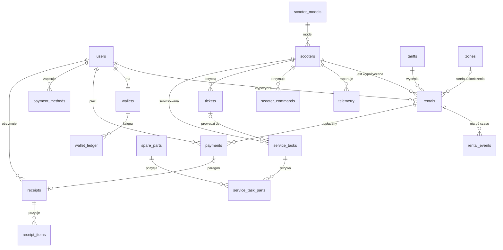
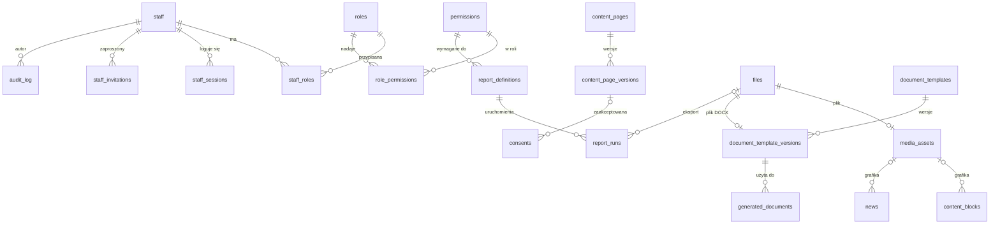

# Model danych

PostgreSQL 16 z PostGIS. Źródłem prawdy o schemacie są migracje w [`packages/db/migrations`](../../packages/db/migrations) ([ADR 0021](../adr/0021-migracje-sql-schemat-drizzle-z-bazy.md)):

- `0001_init.sql`: schemat początkowy, 24 tabele. Jego projekt z komentarzami to [`schema.sql`](schema.sql) (wersja 1, sprawdzona na PostgreSQL 16 i PostGIS 3.4).
- `0002_admin_modules.sql`: role i uprawnienia, treści, raporty, wydruki, serwis i paragony oraz widoki, funkcje i procedury ([ADR 0026](../adr/0026-logika-w-bazie-widoki-funkcje-procedury.md)–[0031](../adr/0031-wzorzec-widoku-tabeli-w-panelu.md)).
- `0003_fleet_lists.sql` (iteracja 1): status floty widoczny dla operatora (`fn_fleet_status`, `fn_low_battery_threshold`), listy floty i modeli w panelu (`v_fleet_list`, `v_scooter_models`), indeksy sortowania po ostatnim sygnale i komend bez potwierdzenia ([ADR 0033](../adr/0033-telemetria-i-status-floty.md)).
- `0004_accounts_access.sql` (iteracja 2): sesje i zaproszenia operatorów (`staff_sessions`, `staff_invitations`), TOTP potwierdzony kodem i blokada po nieudanych logowaniach, blokada klienta z powodem, rodziny tokenów odświeżających, „najważniejsze zmiany” wersji dokumentu, listy ról, klientów, zgód i dziennika audytu, strażnik ostatniego operatora z `roles.manage` ([ADR 0019](../adr/0019-uwierzytelnianie.md), [ADR 0028](../adr/0028-uzytkownicy-role-uprawnienia.md)).
- `0005_rentals.sql` (iteracja 3): nowe zdarzenia osi czasu (`END_REQUESTED`, `PAUSE_FAILED`, `RESUME_FAILED`, `LOCK_FAILED`, `ENDED_REMOTELY`, `LATE_UNLOCK_LOCKED`), termin ważności i powód odmowy komendy, najwyżej jedna komenda w toku na przejazd, portfel zakładany wyzwalaczem przy rejestracji (i uzupełniony dla istniejących klientów), preferencje powiadomień klienta, saldo różne od 0 blokujące usunięcie konta, widoki przejazdów w panelu, osi czasu, historii i statystyk klienta, trasa przejazdu z telemetrii, czyszczenie sesji i zaproszeń ([ADR 0036](../adr/0036-proces-wypozyczenia-w-api.md)–[0042](../adr/0042-wycena-przejazdu.md)).

Po migracji 0005 baza ma **48 tabel** (bez partycji telemetrii i bez schematu `pgboss` kolejki zadań, [ADR 0037](../adr/0037-pg-boss-konfiguracja-i-zadania.md)), **21 widoków**, **11 funkcji** i **9 procedur**; liczby sprawdza test w `packages/db/src/db.test.ts`. Kluczowe zasady opisują też [ADR 0010](../adr/0010-postgresql-postgis-drizzle.md), [ADR 0013](../adr/0013-rezerwacja-jako-stan-przejazdu.md), [ADR 0014](../adr/0014-kwoty-w-groszach-portfel-ksiega.md) i [ADR 0015](../adr/0015-wersjonowany-cennik.md).

## Obszary

| Obszar | Tabele |
|---|---|
| Konta | `users`, `consents`, `otp_codes`, `sessions`, `push_tokens`, `saved_places`, `staff`, `staff_sessions`, `staff_invitations` |
| Role i uprawnienia | `permissions`, `roles`, `role_permissions`, `staff_roles` |
| Przejazdy | `rentals`, `rental_events`, `tariffs` |
| Flota i strefy | `scooters`, `scooter_models`, `telemetry` (partycje dzienne), `scooter_commands`, `zones` |
| Płatności | `wallets`, `wallet_ledger`, `payments`, `payment_methods`, `payment_webhook_events`, `receipts`, `receipt_items` |
| Operacje | `tickets`, `ticket_photos`, `files`, `notifications`, `audit_log` |
| Serwis | `service_tasks`, `spare_parts`, `service_task_parts` |
| Treści | `content_pages`, `content_page_versions`, `content_blocks`, `faq_items`, `news`, `notification_templates`, `media_assets` |
| Raporty i wydruki | `report_definitions`, `report_runs`, `document_templates`, `document_template_versions`, `generated_documents` |

Konwencje: identyfikatory `uuid`, kwoty w groszach (`bigint`), czas `timestamptz` w UTC, geometria SRID 4326. Tabele edytowalne w panelu mają kolumnę `version` do blokady optymistycznej ([ADR 0031](../adr/0031-wzorzec-widoku-tabeli-w-panelu.md)); numery wersji biznesowych to `version_no` (dokumenty, szablony) albo `tariffs.version` (cennik).

## Diagram relacji: przejazdy, flota i płatności

## Diagram relacji: panel (uprawnienia, treści, raporty, wydruki)

## Reguły pilnowane przez bazę

- Jeden otwarty przejazd na hulajnogę i na użytkownika (`rentals_one_open_per_scooter`, `rentals_one_open_per_user`).
- Jedno obciążenie portfela za przejazd (`wallet_ledger_one_charge_per_rental`).
- Jedna domyślna metoda płatności na użytkownika.
- Unikalne `idempotency_key` i `provider_payment_id` płatności oraz `provider_event_id` webhooków.
- Usunięte konto nie ma telefonu ani e-maila (`CHECK` w `users`).
- Jedna obowiązująca wersja dokumentu (`content_page_versions_one_published`) i jedna aktywna wersja szablonu wydruku (`document_template_versions_one_active`); jeden szablon domyślny na rodzaj dokumentu.
- Najwyżej jedno otwarte zadanie serwisowe danego rodzaju na hulajnogę (`service_tasks_one_open_per_type`); zadanie w toku ma wykonawcę, zakończone ma datę zakończenia.
- Roli przypisanej operatorom nie da się usunąć (klucz obcy w `staff_roles` bez kaskady).
- Jeśli istnieje konto operatora, co najmniej jeden aktywny operator ma `roles.manage`: odroczone wyzwalacze ograniczeń na `staff`, `staff_roles` i `role_permissions` wywołują `fn_check_role_manager` przy zatwierdzeniu transakcji (błąd `LAST_ROLE_MANAGER`). W jednej transakcji można więc nadać rolę następcy i odebrać własną.
- Zablokowany klient ma datę i powód blokady, a niezablokowany nie ma żadnego z nich (`users_block_consistent`).
- Zastąpiona sesja (klienta i operatora) jest unieważniona (`replaced_by` wymaga `revoked_at`); następca dziedziczy `family_id`, więc ponowne użycie starego tokenu pozwala unieważnić całą rodzinę.
- Operator ma najwyżej jedno otwarte zaproszenie (`staff_invitations_one_open`); TOTP potwierdzony wymaga zapisanego sekretu.
- Zgoda na tę samą wersję dokumentu jest zapisana najwyżej raz (`consents_one_active_per_version`); dla dokumentów z modułu treści `document_version` to numer wersji, a `page_version_id` wskazuje wersję.
- Raport zakończony sukcesem ma plik, a zakończony błędem ma opis błędu (`report_runs`, `generated_documents`).
- Plik ma najwyżej jednego autora: klienta albo operatora (`files_one_uploader`).

## Widoki, funkcje i procedury

Podział pracy między bazą a `packages/core` opisuje [ADR 0026](../adr/0026-logika-w-bazie-widoki-funkcje-procedury.md): baza odczytuje, liczy na danych i wykonuje operacje na zbiorach wierszy, decyzje biznesowe podejmuje core.

| Widok | Zastosowanie |
|---|---|
| `v_fleet_status` | lista floty: model, bieżący przejazd, strefa parkowania, otwarte zgłoszenia i zadania, przejazdy z 30 dni |
| `v_rental_details` | lista i szczegóły przejazdów z użytkownikiem, hulajnogą, wersją cennika, strefą i płatnością; od 0005 także czas od odblokowania, flaga problemu (nieudane odblokowanie, hulajnoga offline, niepotwierdzona komenda) i komenda w toku |
| `v_rental_timeline` | oś czasu przejazdu: zdarzenia i komendy z wynikiem w jednej kolejności (panel, szczegóły) |
| `v_user_rental_history` | historia przejazdów klienta w aplikacji (tylko przejazdy, które się odbyły) |
| `v_user_ride_stats` | statystyki profilu: liczba przejazdów, dystans, czas w drodze |
| `v_wallet_balances` | saldo z pamięci podręcznej porównane z księgą (`out_of_sync`) |
| `v_daily_revenue` | raport przychodów: przejazdy, doładowania i zwroty według dnia (Europe/Warsaw) |
| `v_ticket_queue` | kolejka otwartych zgłoszeń z ostatnim zadaniem serwisowym |
| `v_staff_permissions` | uprawnienia aktywnych operatorów jako suma ról |
| `v_staff_overview` | lista operatorów z rolami, statusem (aktywny, zaproszony, dezaktywowany), ostatnim logowaniem, liczbą sesji i zaproszeniem; bez skrótu hasła i sekretu TOTP |
| `v_zone_usage` | raport przejazdów zakończonych w strefach według dnia |
| `v_scooter_reliability` | raport awaryjności: zgłoszenia, zadania, średni czas naprawy, koszt części |
| `v_user_activity` | lista klientów i raport użytkowników: przejazdy, wydatki, saldo, blokada, aktywne sesje, ostatnia aktywność |
| `v_current_documents` | obowiązujące wersje regulaminu i innych dokumentów |
| `v_published_news` | aktualności w okresie publikacji |
| `v_low_stock_parts` | części poniżej stanu minimalnego |
| `v_fleet_list` | lista floty i mapa w panelu: `v_fleet_status` ze statusem floty, współrzędnymi, zasięgiem modelu i wersją rekordu |
| `v_scooter_models` | lista modeli z liczbą hulajnóg (wszystkich i nie wycofanych) |
| `v_roles_overview` | lista ról z liczbą uprawnień i aktywnych operatorów |
| `v_user_consents` | ostatnia zgoda klienta każdego rodzaju i to, czy dotyczy obowiązującej wersji dokumentu |
| `v_audit_log` | dziennik audytu z nazwą i e-mailem operatora |

| Funkcja | Wynik |
|---|---|
| `fn_zones_at_point(lon, lat)` | aktywne strefy w punkcie, od najbardziej restrykcyjnej |
| `fn_nearest_scooters(lon, lat, radius_m, limit, min_battery)` | dostępne hulajnogi w promieniu, od najbliższej; próg baterii przekazuje core |
| `fn_wallet_balance(user_id)` | saldo jako suma księgi |
| `fn_staff_has_permission(staff_id, code)` | czy operator ma uprawnienie |
| `fn_rental_distance_m(rental_id)` | długość trasy z telemetrii w metrach |
| `fn_rental_route(rental_id)` | trasa przejazdu z telemetrii (`LineString`), zapisywana w `rentals.route` przy zakończeniu |
| `fn_content_revision()` | licznik zmian treści (ETag) |
| `fn_low_battery_threshold()` | próg niskiej baterii: minimalna bateria do wypożyczenia z obowiązującej wersji cennika |
| `fn_fleet_status(status, online, battery_pct, threshold)` | status floty dla operatora; ta sama reguła co `deriveFleetStatus` w `packages/core` (zgodność sprawdza test bazy) |
| `fn_user_pending_documents(user_id)` | obowiązujące dokumenty ze zgodą, których aktualnej wersji klient nie zaakceptował (z „najważniejszymi zmianami”) |
| `fn_check_role_manager()` | funkcja wyzwalacza: odrzuca zmianę, po której żaden aktywny operator nie ma `roles.manage` |

| Procedura | Działanie | Uruchamia |
|---|---|---|
| `sp_expire_reservations(OUT expired_count)` | `RESERVED → EXPIRED`, zdarzenie na osi czasu, zwolnienie hulajnogi | narzędzie bazy; aplikacja wygasza rezerwacje zadaniem pg-boss przez repozytorium, żeby klient i panel dostali zdarzenie ([ADR 0037](../adr/0037-pg-boss-konfiguracja-i-zadania.md)) |
| `sp_anonymize_user(user_id)` | usunięcie danych osobowych; odmowa przy otwartym przejeździe i (od 0005) przy saldzie różnym od 0 | `DELETE /me` w aplikacji, panel |
| `sp_ensure_telemetry_partitions(from, days, OUT created_count)` | dzienne partycje telemetrii (UTC) z przeniesieniem wierszy z partycji domyślnej | moduł Telemetria przy starcie API i zadanie cykliczne pg-boss `telemetry.partitions` (7 dni naprzód) |
| `sp_purge_telemetry(keep_days, OUT dropped_count)` | retencja telemetrii | zadanie cykliczne pg-boss |
| `sp_purge_expired_otp(OUT deleted_count)` | usunięcie przeterminowanych kodów SMS | zadanie cykliczne pg-boss `auth.purge` |
| `sp_purge_expired_sessions(keep_days, OUT deleted_count)` | usunięcie całych rodzin sesji klientów i operatorów bez ważnego tokenu oraz nieprzyjętych zaproszeń, wygasłych dawniej niż `keep_days` | zadanie cykliczne pg-boss `auth.purge` (30 dni) |
| `sp_rebuild_wallet_balances(OUT fixed_count)` | naprawa pamięci podręcznej salda według księgi | panel, w razie rozjazdu |
| `sp_revoke_user_sessions(user_id, OUT revoked_count)` | wylogowanie klienta ze wszystkich urządzeń | blokada konta, panel |
| `sp_revoke_staff_sessions(staff_id, OUT revoked_count)` | wylogowanie operatora ze wszystkich urządzeń | dezaktywacja, zmiana e-maila, reset TOTP |

Wyzwalacz `trg_content_revision` zwiększa licznik `content_revision_seq` przy każdej zmianie w tabelach treści. Wyzwalacz `trg_user_wallet` (0005) zakłada portfel z saldem 0 przy każdym nowym kliencie.

## Operacje w panelu dla każdej tabeli

Realizacja wymagania 12 według [ADR 0031](../adr/0031-wzorzec-widoku-tabeli-w-panelu.md). Każda tabela ma w panelu listę z filtrowaniem, sortowaniem i stronicowaniem oraz widok szczegółów; kolumny poniżej mówią, jak działa dodawanie, edycja i usuwanie. Uprawnienia: [ADR 0028](../adr/0028-uzytkownicy-role-uprawnienia.md).

| Tabela | Klasa | Źródło listy | Dodaj | Edytuj | Usuń | Uprawnienia |
|---|---|---|---|---|---|---|
| `users` | encja | `v_user_activity` | rejestracja w aplikacji | dane, blokada i odblokowanie | anonimizacja (`sp_anonymize_user`) | `users.read`, `users.manage` |
| `consents` | proces | `consents` | akceptacja w aplikacji | wycofanie zgody | nie | `users.read` |
| `otp_codes` | techniczna | `otp_codes` (bez skrótu kodu) | nie | nie | `sp_purge_expired_otp` | `users.manage` |
| `sessions` | techniczna | `sessions` (bez skrótu tokenu) | nie | nie | unieważnienie | `users.manage` |
| `staff_sessions` | techniczna | sesje w karcie operatora (bez skrótu tokenu) | logowanie | nie | unieważnienie | `staff.manage` |
| `staff_invitations` | proces | zaproszenie w karcie operatora | zaproszenie | ponowne wysłanie (nowy wiersz) | unieważnienie | `staff.manage` |
| `push_tokens` | techniczna | `push_tokens` | nie | nie | tak | `users.manage` |
| `saved_places` | encja klienta | `saved_places` | w aplikacji | w aplikacji | tak | `users.read`, `users.manage` |
| `staff` | encja | `v_staff_overview` | zaproszenie | dane, role, reset TOTP | dezaktywacja | `staff.read`, `staff.manage` |
| `permissions` | słownik z kodu | `permissions` | z katalogu w core | opis | nie | `roles.manage` |
| `roles` | słownik | `roles` | tak | tak | tak, jeśli nieprzypisana i nie systemowa | `roles.manage` |
| `role_permissions` | słownik | macierz w edycji roli | tak | — | tak | `roles.manage` |
| `staff_roles` | encja | edycja operatora | tak | — | tak | `staff.manage` |
| `tariffs` | wersjonowana | `tariffs` | nowa wersja | nowa wersja | nie | `tariffs.read`, `tariffs.write` |
| `rentals` | proces | `v_rental_details` | przez proces wypożyczenia | polecenia: zakończenie zdalne, zwrot | nie | `rentals.read`, `rentals.manage` |
| `rental_events` | tylko do dopisywania | `rental_events` | system | nie | nie | `rentals.read` |
| `scooters` | encja | `v_fleet_list` (od iteracji 1) | tak | tak, komendy przez `scooter_commands` | wycofanie (`RETIRED`) | `scooters.read`, `scooters.write` |
| `scooter_models` | słownik | `v_scooter_models` (od iteracji 1) | tak | tak | archiwizacja, jeśli używany | `scooters.write` |
| `telemetry` | tylko do dopisywania | `telemetry` (kursor, zakres czasu) | system | nie | retencja (`sp_purge_telemetry`) | `telemetry.read` |
| `scooter_commands` | proces | `scooter_commands` | wysłanie komendy | nie | nie | `scooters.command` |
| `zones` | słownik | `zones` | tak | tak | dezaktywacja, jeśli używana | `zones.read`, `zones.write` |
| `wallets` | encja | `v_wallet_balances` | z kontem klienta | tylko przez księgę; naprawa `sp_rebuild_wallet_balances` | nie | `payments.read` |
| `wallet_ledger` | tylko do dopisywania | `wallet_ledger` | korekta jako nowy wpis | nie | nie | `payments.read`, `wallet.adjust` |
| `payments` | proces | `payments` | przez proces płatności | polecenie: zwrot | nie | `payments.read`, `rentals.manage` |
| `payment_methods` | encja klienta | `payment_methods` | w aplikacji | nie | usunięcie (`removed_at`) | `users.manage` |
| `payment_webhook_events` | tylko do dopisywania | `payment_webhook_events` | system | nie | nie | `payments.read` |
| `receipts` | tylko do dopisywania | `receipts` | system przy płatności | nie | nie | `payments.read` |
| `receipt_items` | tylko do dopisywania | szczegóły paragonu | system | nie | nie | `payments.read` |
| `tickets` | encja | `v_ticket_queue`, `tickets` | tak (źródło `STAFF`) | status, wykonawca, pilność | zamknięcie (`RESOLVED`) | `tickets.read`, `tickets.manage` |
| `ticket_photos` | encja | szczegóły zgłoszenia | tak | — | tak | `tickets.manage` |
| `files` | techniczna | `files` | przez moduł, który używa pliku | nie | tak, jeśli nieużywany | uprawnienie modułu |
| `notifications` | tylko do dopisywania | `notifications` | system | nie | nie | `users.read` |
| `audit_log` | tylko do dopisywania | `v_audit_log` (filtry: operator, rodzaj obiektu, zakres czasu) | system, w transakcji zapisu | nie | nie | `audit.read` |
| `service_tasks` | encja | `service_tasks` | tak | przejścia statusu, wykonawca | anulowanie (`CANCELLED`) | `service.read`, `service.manage` |
| `spare_parts` | słownik | `spare_parts`, `v_low_stock_parts` | tak | tak | archiwizacja, jeśli używana | `service.manage` |
| `service_task_parts` | encja | szczegóły zadania | tak | ilość | tak, dopóki zadanie otwarte | `service.manage` |
| `content_pages` | słownik | `content_pages` | tak | tak | tak, jeśli bez opublikowanych wersji | `content.read`, `content.write` |
| `content_page_versions` | wersjonowana | wersje dokumentu | nowa wersja | szkic; publikacja | archiwizacja | `content.write` |
| `content_blocks` | słownik | `content_blocks` | tak | tak | tak | `content.write` |
| `faq_items` | słownik | `faq_items` | tak | tak | tak | `content.write` |
| `news` | słownik | `news` | tak | tak | tak | `content.write` |
| `notification_templates` | słownik | `notification_templates` | nie (kody z kodu) | tak | nie | `content.write` |
| `media_assets` | słownik | `media_assets` | tak | tak | tak, jeśli nieużywana | `content.write` |
| `report_definitions` | słownik z kodu | `report_definitions` | z katalogu w core | nazwa, opis, aktywność | nie | `content.write` |
| `report_runs` | proces | `report_runs` | uruchomienie raportu | nie | nie | `reports.<kod>` |
| `document_templates` | słownik | `document_templates` | tak | tak | dezaktywacja | `templates.read`, `templates.write` |
| `document_template_versions` | wersjonowana | wersje szablonu | wgranie nowej wersji | aktywacja | nie | `templates.write` |
| `generated_documents` | proces | `generated_documents` | wygenerowanie wydruku | nie | nie | `documents.generate` |
