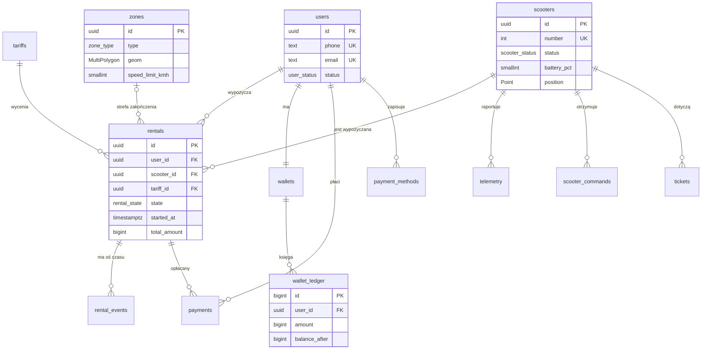

# Model danych

PostgreSQL 16 z PostGIS. Pełny schemat: [`schema.sql`](schema.sql) (24 tabele, sprawdzony na PostgreSQL 16 i PostGIS 3.4). Kluczowe zasady opisują [ADR 0010](../adr/0010-postgresql-postgis-drizzle.md), [ADR 0013](../adr/0013-rezerwacja-jako-stan-przejazdu.md), [ADR 0014](../adr/0014-kwoty-w-groszach-portfel-ksiega.md) i [ADR 0015](../adr/0015-wersjonowany-cennik.md).

## Obszary

| Obszar | Tabele |
|---|---|
| Konta | `users`, `consents`, `otp_codes`, `sessions`, `push_tokens`, `saved_places`, `staff` |
| Przejazdy | `rentals`, `rental_events`, `tariffs` |
| Flota i strefy | `scooters`, `telemetry` (partycje dzienne), `scooter_commands`, `zones` |
| Płatności | `wallets`, `wallet_ledger`, `payments`, `payment_methods`, `payment_webhook_events` |
| Operacje | `tickets`, `ticket_photos`, `files`, `notifications`, `audit_log` |

## Diagram relacji (najważniejsze tabele)

## Reguły pilnowane przez bazę

- Jeden otwarty przejazd na hulajnogę i na użytkownika (`rentals_one_open_per_scooter`, `rentals_one_open_per_user`).
- Jedno obciążenie portfela za przejazd (`wallet_ledger_one_charge_per_rental`).
- Jedna domyślna metoda płatności na użytkownika.
- Unikalne `idempotency_key` i `provider_payment_id` płatności oraz `provider_event_id` webhooków.
- Usunięte konto nie ma telefonu ani e-maila (`CHECK` w `users`).
